# ぼぎだぢの世界

人がいなくなったあとの世界で、民芸品や玩具が、いまも何かを続けています。宇宙船の部品を出荷し、テレビ番組を撮り、毎朝爆撃機を送り出す。見ている人は、もういません。

ゲーム「ぼぎだぢ」は、その世界のかけらを、小さな器物「きー」が歩いていく探索 RPG です。このページは、遊ぶ前の道案内です。作者の言葉が正典なので、引用は作者の言葉のまま載せています。断片の結末と、ゲームの結末は書いていません。

**遊ぶ**: https://bibiman1.github.io/bogidadi/ (ブラウザで、パソコンでもスマホでも。登録なし、無料。English も選べます)

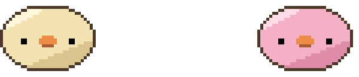

*きー(左)とぴー(右)。*

---

## あらすじ

> 偶然と手違いが積み重なり、時空連続体の泡として投下された超現実爆弾は、事象の蓋然性を攪乱する。
> やがて世界は静まり、人が遠くに去ったあとの時代。
> 自助努力と交雑した民芸品や玩具達が、囁いたり、徘徊したりする物語。

## アフターマンエイジ

人が去ったあとの時代を、作者は「アフターマンエイジ」と呼んでいます。

> アフターマンエイジは大きな戦いの後の傷を負った世界。人間は去ったが、ぼぎだぢはちゃんの残滓として、わけもわからずに戦争を継続しているが、明確に敵がいるわけでもない。ぼぎだぢは習慣づけとして、人間たちがやっていたことをまねているだけ。ただ、あまり戦争色を出さなくてもいい。戦争の破壊からときがたっており、自然はたくましく復興していて、のどかな世界がベースで。さらに超現実爆弾の影響で、惑星混交や理不尽で奇妙なものがごちゃまぜになっている

空には、欠けて破片の輪をまとった月が出ています。地軸が曲がり、気象が変わって、南極ではバナナが実ります。ゲームの中では説明しません。絵の中に、そっと置いてあります。

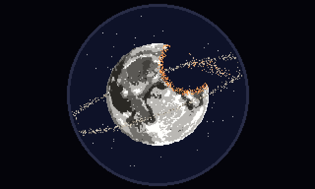

*望遠鏡でのぞいた月。*

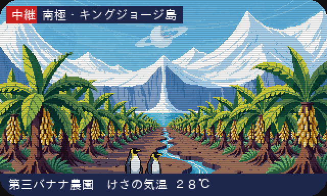

*どこかのテレビに映る中継。「南極・キングジョージ島／第三バナナ農園 けさの気温 28℃」。*

## ぼぎだぢ

- **ぼぎ**: 人が遠くに去ったあとの時代を徘徊する、主に動物を模した器物。または、「ちゃん」と一次接触した古いぼぎ。
- **ぼぎだぢ**: ぼぎを含む、器物の総称。
- **ちゃん**: 人間。

**きー**は、この物語の主人公です。

> 最古のぼぎ。「ちゃん」と別れ、生老病死と万物流転の意味を理解するが、忘失。ただ一つ記憶している「ださいおさむん」を探しながら世界を徘徊するが、やがて、目的からも衝動からも解放され、あるがままを感じる事に努めだす。

見た目は、作者いわく「つぶれた饅頭のような形。正面から見ても横から見ても楕円。手足はない。耳はない。鼻の穴はない。目は鼻と同じ高さの、真っ黒な点」。

**ぴー**も最古のぼぎで、「きーの邪魔をすることに執着する。別名、悪魔」。きーと同じ形の、ピンクの色違いです。

ほかにも、たくさんのぼぎだぢがいます。

- **きこり**: 最古のぼぎ。リモコンの豚。動きが素早く、気まぐれ。
- **ちりん**: 最古のぼぎ。割れた所を漆で金継ぎされた風鈴。きこりに執着する。
- **ききこり**: 最古のぼぎ。電動の豚。自分の大きさに執着する。
- **ごろん**: 最古のぼぎ。ピギーバンク。
- **鉄瓶**: 怒れる南部鉄器。
- **マトリョーシカ**: 交戦的。
- **ミイラさま**: 霞ヶ浦に停泊する戦闘エクラノプランのコックピットに座っている死体。ぼぎを乗せて、遊覧飛行をしてくれる。
- **地上ぼぎクルー**: 古い命令に従い、いまだにぼぎボマーを整備している笹野一刀彫。
- **みとん**: 車箪笥を家にして乗り回す。眼鏡と真珠の首飾りをした、豚の顔の背の高い姿。
- **とりぼぎかー**: 親鴨が桶を引く車。作者いわく「グレートアトラクターにけん引されて駆動する宇宙的な動力源を持っている」。桶の上の円形の台座に子鴨が 3 羽並び、前進すると子鴨のくちばしからジェットが出て、台座が回る。

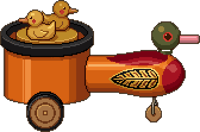

## 懲罰空間と 10 の断片

ゲームは「懲罰空間」から始まります。何もない、白い空間です。

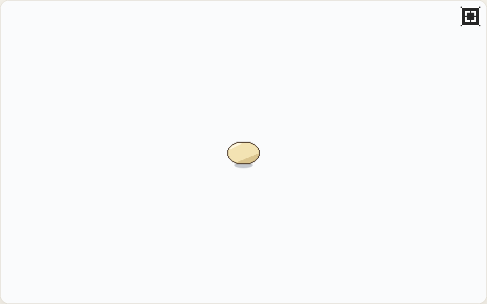

歩いていくと、台座に置かれた小さな模型が見えてきます。これが世界の「断片」です。触れると、きーの記憶の世界や、混ざりあった惑星の一角に入ります。

言葉は少なく、説明はしません。きーはあまり話さず、意味のわからない言葉(「ちゃん」「ほうとう」)をつぶやくだけです。意味は、絵と体験で少しずつわかってきます。

断片は 10 個あり、4 つの段に分かれています。段の中は好きな順で回れて、その段をすべて終えると、次の段の模型が現れます。断片の中で、きーは少しずつできることが増えていきます(おす、ジャンプ、てらす、はしる、ふんばる、まわる)。ある断片で覚えたことで、別の断片の見落としていた場所に手が届きます。

### 1 段: 凍った湖と富士山

*「きーが見た風景。」*

雪の峠道を下りていくと、凍った湖と富士山が見えてきます。道ばたには、ちゃんの車。湖のほとりには、湯気の立つほうとう屋。**ほうとう**は、きーが凍った湖と富士山を見たあとに食べたものです。

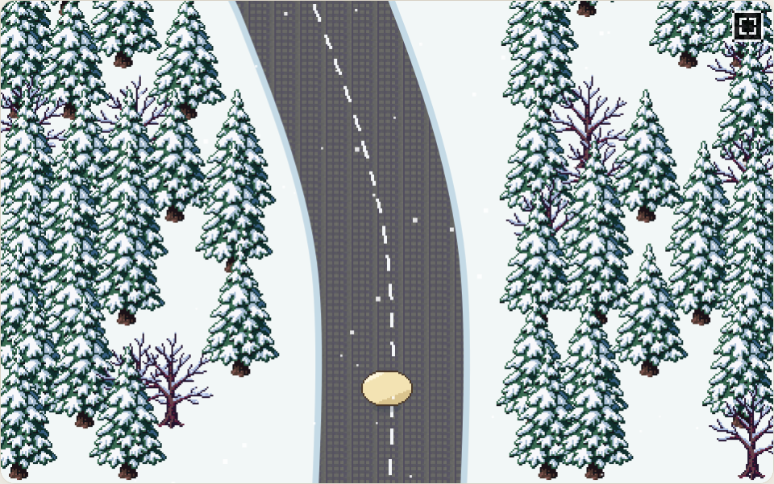

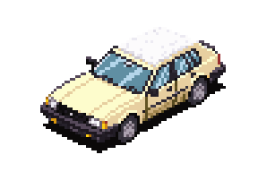

### 2 段: アンバリッド・ホテル

*「Hi Hey Win！」*

秋の夕方、高原の「国立アンバリッド・ホテル」。ぼぎだぢは、ここを「Hi Hey Win！」という音で覚えています。

作者の言葉では、「超現実爆弾が炸裂した後も、廃兵院には傷痍軍人がしばらく穏やかに暮らしていた。民芸品や玩具を手すさびで作っていた。死人とぼぎだぢは仲が良い」。手ざわりは「物悲しいが怖くない。リリカルな世界。サナトリウムのような穏やかな世界」。

中庭の人は温かい灰色の影になり、車椅子や楽器だけが、そのまま残っています。受付で台紙をもらって、文化祭のスタンプを集めて回ります。

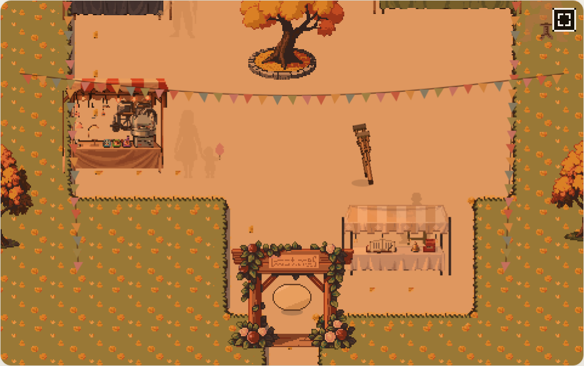

*今の中庭。人は影になって、物だけが残っている。*

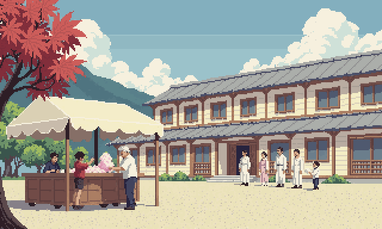

*思い出の一枚絵。文化祭の日。*

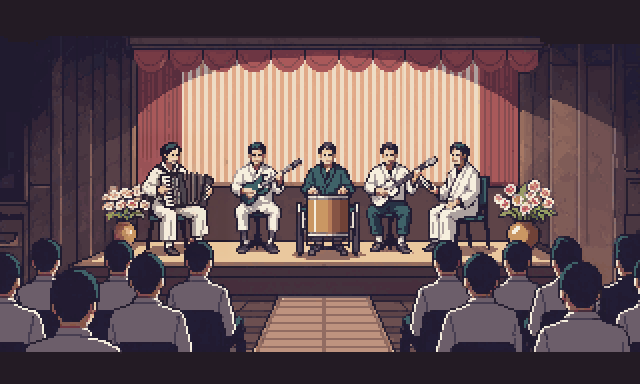

### 2 段: 霞ヶ浦のエクラノプラン

*「ミイラさまの遊覧飛行。」*

かつての海軍航空基地の跡。蓮田の向こうの湖に、錆びた巨大なエクラノプラン(船と飛行機のあいだの乗り物)が停泊しています。自然に呑まれかけた、のどかな湖畔です。

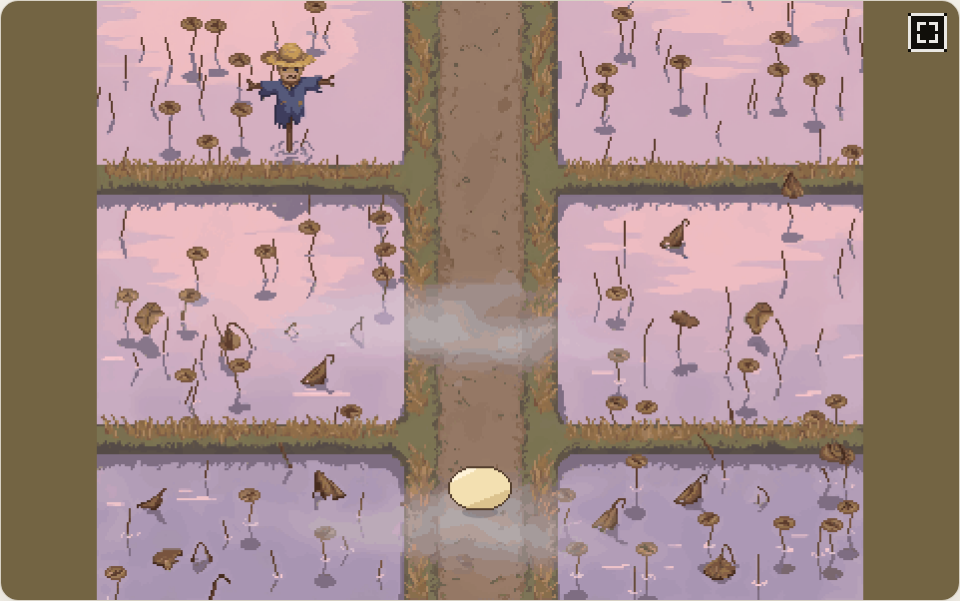

コックピットには、高高度用のパイロットスーツを着た**ミイラさま**が座っています。話しかけると、ロシア語で聞いてきます。「Здравствуй, маленький друг! Хочешь совершить прогулочный полёт?」(こんにちは、小さな友だち。遊覧飛行をするかい?)

機体のまわりでは、**地上ぼぎクルー**が今朝も整備をしています。きーは、ここで彼らからジャンプを習います。

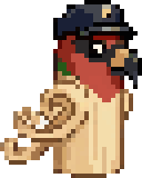

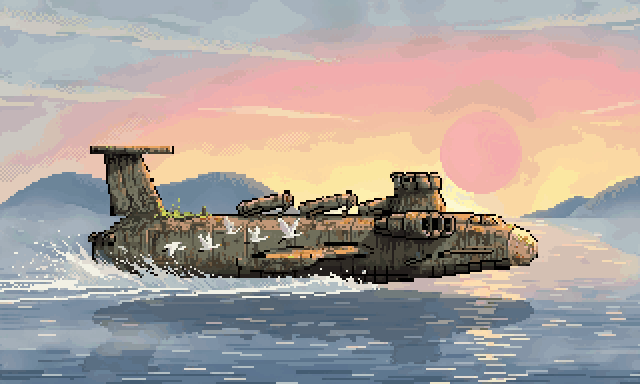

### 2 段: 荒川の鈴木商店

*「宛先がにじんで読めない。」*

雨上がりの夕方の、荒川区の下町。都電の停留場、町工場と長屋の路地、荒川の土手。設定資料には「荒川区にある宇宙船殻用単結晶の製造販売卸元。超現実爆弾が招いた、現実には存在しない会社の看板」とあります。錆びた看板には「宇宙船殻用単結晶　製造・販売・卸 / 鈴木商店 / 東京・群馬・水星・北京」。

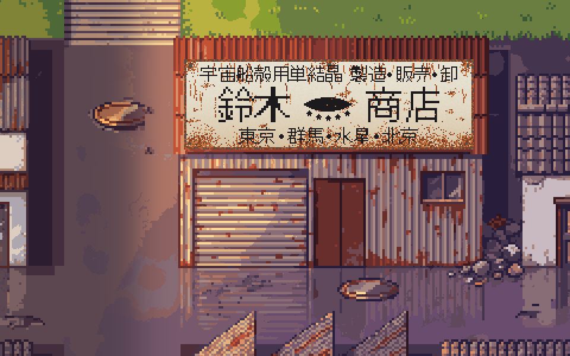

*町工場と長屋の路地。看板の文面と形は、作者の手書きの下絵から。*

店番は**鉄瓶**。しゃべらず、怒ると湯気を噴きます。河川敷には、宇宙船の船殻になる、透明な単結晶が寝ています。きーは伝票と荷札を手に、その穴から中へ入ります。

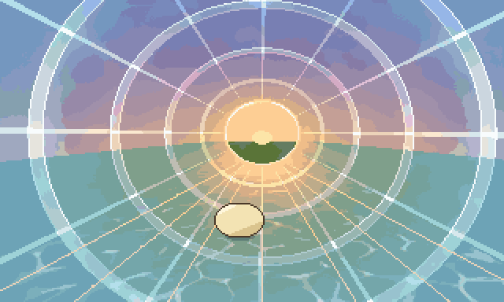

*単結晶の中。ビンの中にいるような、透明な筒。*

### 3 段: 南極のバナナ農園

*「けさの気温 28℃。」*

今の南極・キングジョージ島。設定資料には「気候も日照も意味を問われなくなったので、やる気のある植物が繁茂している」。**バナナ農園**は「ぼぎのテレビ企画」です。ぼぎたちが、人間のテレビ番組を習慣でまねて、いまも撮り続けています。見ている人は、もういません。

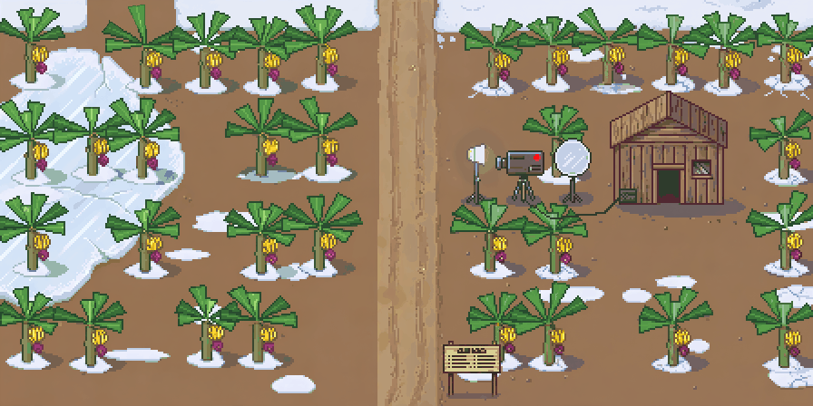

*第三バナナ農園。雪の上にバナナが実り、奥に撮影の道具と農具小屋。*

白夜の薄明かりに、欠けた月。浜にはペンギン、丘の上には木造の教会。マンゴーを食べに来た**きこり**を、**ちりん**と一緒に追いかけます。

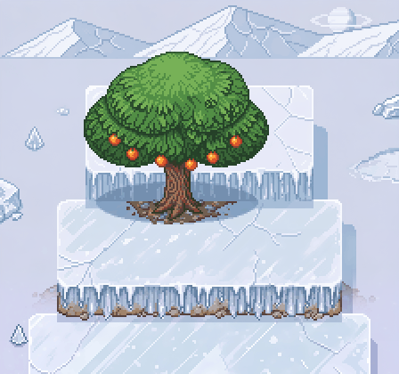

### 3 段: 宝舟と首振りエンジン

*「何も描かれていない。」*

欠けた月の夜の、名前のない小さな漁港。**宝舟**は、設定資料では「未踏海域を調査するためにぼぎが片手間でつくった木造船」。七福神の宝船の形を、ぼぎが廃材で組みました。主機関の**首振りエンジン**は、ぼぎが青銅で鋳造します。

作者の言葉です。「原子炉の燃料を採取して、蒸気機関の熱源にする。宝船に乗って漁にでる。沖で燃料をばら撒くと、青い光で海が美しく光る。」

岬の上には、止まった発電所。作者の言葉では「発電所は区画が複数あり、きーはどんどん中に入っていく。明らかに危険な区画でもおかまいなしに進んでいく。」

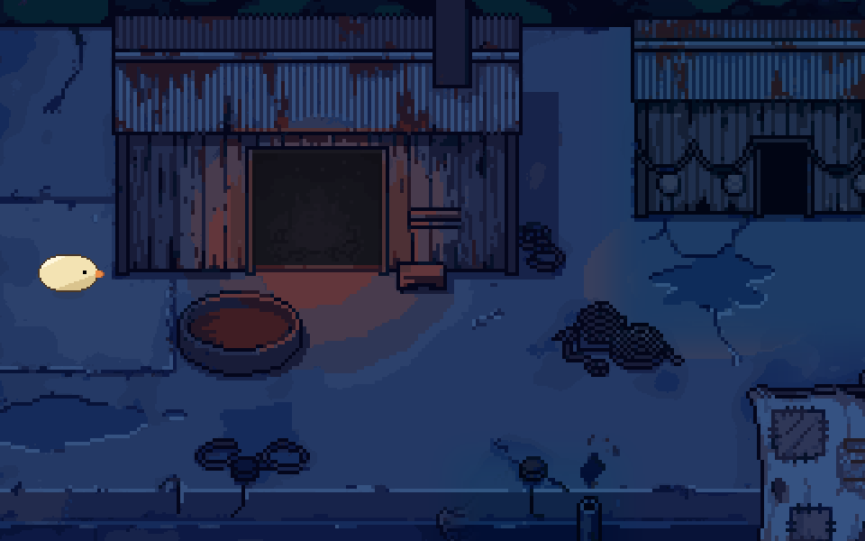

*夜の漁港。*

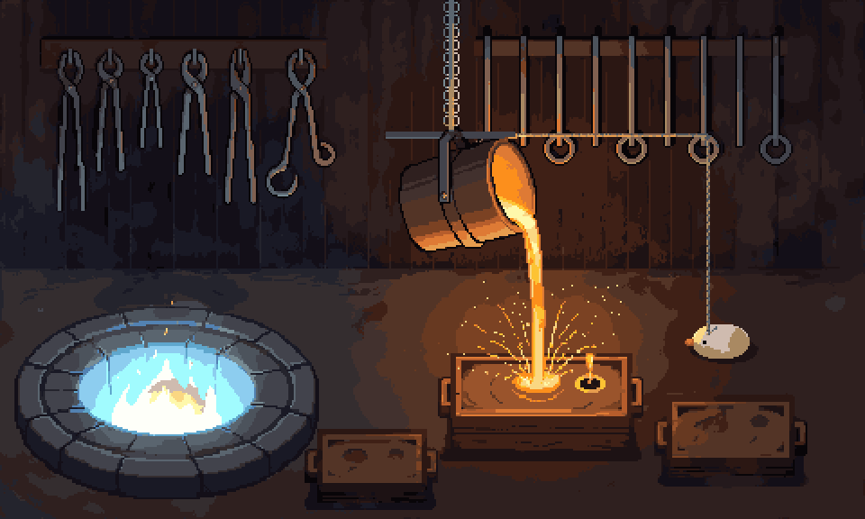

*鋳造工房。*

### 3 段: 呪いの野犬

*「ポン　ポン　ポン。」*

**呪いの野犬**は「フリーウェイにのさばる荒くれぼぎだぢのチーム名」。真昼の峠道のトンネルを抜けると、ルート 66 のような砂漠の旧国道に混ざっています。つぶれたダイナー、消えたネオン、給油機。

作者の言葉では、この断片の芯は「人も車も絶えて久しい寂寥感のある世界で、ちゃんがいなくなっても走らずにいられないアッパー系ぼぎが、抑えきれぬスピードへの衝動を発散している」。

桶で燃やした火から管で熱をもらって走る**ぽんぽんカー**、赤べこのホットロッド、とりぼぎかー。そして、きーの車**ぼぎカー**(ナイロンの戸板用ベアリングのタイヤ、柿渋塗り、光速度と慣性に制限を受けない)。

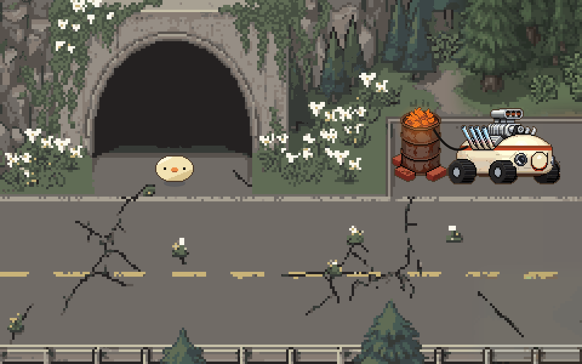

*峠のトンネルの出口。ぽんぽんカーが待っている。*

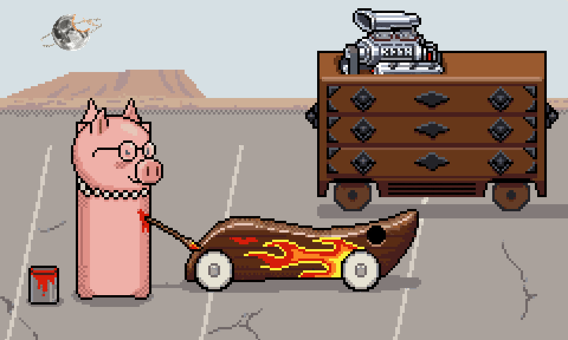

*みとんが、ぼぎカーに炎を塗る。*

### 4 段: ぱーでれとだいにち

*「カチ　カチ。」*

霧の夕暮れの、昭和の町はずれ。拍子木の音がして、空き地に紙芝居屋の自転車が来ています。自転車を引いているのが**ぱーでれ**。設定資料には「ぼぎを捕まえる機械。ぱーでれに連れ去られたぼぎは戻ってこない」とあります。

紙芝居「だいにち」を見に、ぼぎや、壊れたぼぎだぢが集まってきます。物悲しく、少し不穏で、どこか滑稽な断片です。

*霧の中のぱーでれ。*

*紙芝居「だいにち」の一枚目。*

### 4 段: きこりと金星

*「無風、92気圧、456℃、雲。」*

嵐の山。山頂の気象台の向こうには、金星のかけらが混ざり込んでいて、そこだけ硫酸の黄色い雲と陽炎がゆらいでいます。

山道では、南極の撮影隊(カメラ係の**ききこり**、ディレクターの**ごろん**)が、番組を撮りに来ています。きーは、なぜかピザの材料の木箱を押し付けられ、頭にのせて山頂へ運ぶことになります。

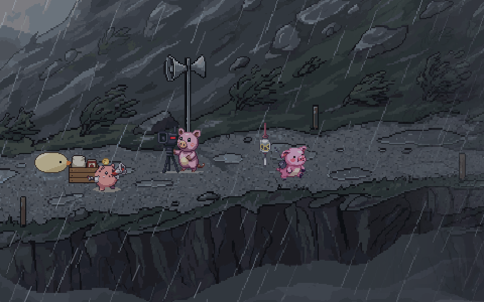

*嵐の山道。撮影隊と、押し付けられた木箱。*

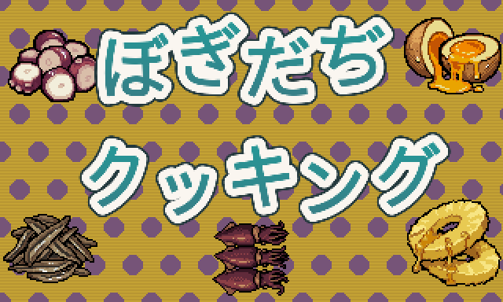

### 4 段: ぼぎボマーと地上ぼぎクルー

*「REMOVE BEFORE FLIGHT」*

草に呑まれかけた、山あいの飛行場の朝。**ぼぎボマー**は「古い命令に従い、いまだに爆装して飛び立つ無人機。どこかに爆弾を投棄して、基地に戻ってくる」。ジュラルミン無塗装の全翼機です。

**地上ぼぎクルー**は、人がいなくなったあとも、毎朝同じ手順で爆弾を運び、発進を見送り、帰りを待っています。きーも、その朝の手順を手伝います。

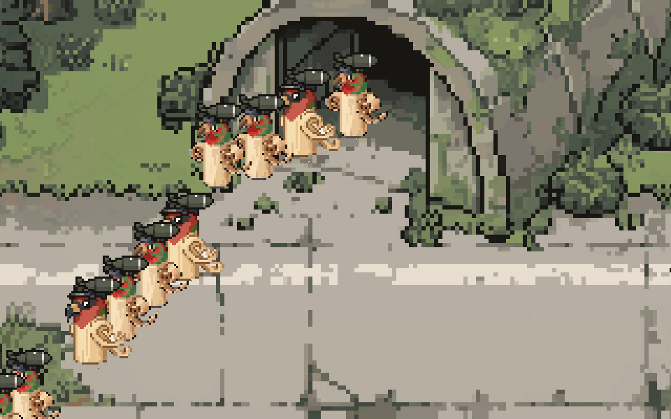

*爆弾を運ぶ地上ぼぎクルー。*

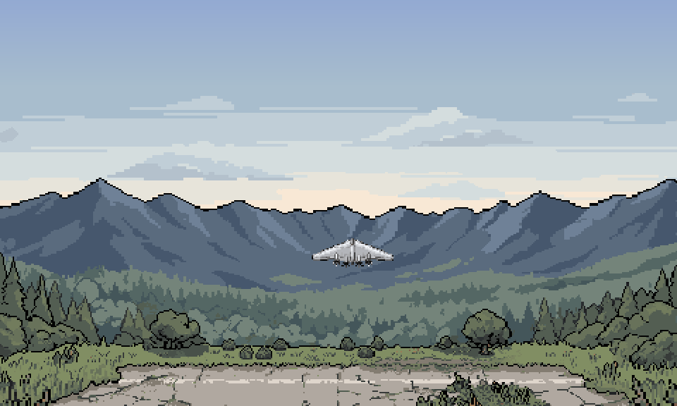

## ことばの手帖

設定資料の用語から、いくつか。

- **ださいおさむん**: ちゃんが「きー」に言い残した言葉。
- **ぼぎカー**: 「きー」の車。ナイロンの戸板用ベアリングをタイヤに持つ。柿渋が塗られており臭い。光速度と慣性に制限を受けない。
- **車箪笥**: 「みとん」の家であり乗物。ヘミ V8 スーパーチャージャーをスワップされている。燃費が悪いが、ガソリンがなくてもみとんが望めば走行する。
- **おばけ**: 形而アップダウンクイズの過程で露出した物自体が、ぼぎに認識された姿。ぼぎとは仲が良い。
- **リンガボガー (Lingua boga)**: ぼぎだちとのコミュニケーションに使われる言葉、ゼスチャー、儀式。
- **ルチ将軍**: 知能指数 1300 の人形。まだドロドロして形をなしていなかった、きーの心に植えつけられたトラウマ。
- **アリ・カカウロ**: 魔法のロバの口と尻の穴から砂金を吐き出させる呪文。
- **青い光漁(チェレンコフ光)**: ぼぎが炉心内部の燃料ペレットをもて遊び、海に投げ込んだ事件。
- **まろうど**: アフターマンエイジのさざ波。実体化した三人称。

---

## ここから先はネタバレ

ゲームの中では明かさない(または、気づく人だけが気づけばよい)設定です。遊び終えてから開いてください。

エクラノプランとミイラさまの秘密

海面すれすれを飛ぶエクラノプランのパイロットが、なぜ高高度用の気密服を着ているのか。作者の言葉です。

> エクラノプランにみえるが、じつは宇宙船ということ。これは気が付く人がいればいいので、明示しなくていい。

ミイラさまのこと。

> エクラノプランのミイラ様は主エンジンが損傷しもう軌道には戻れないことを悟って失意の中で死んだが、ときどき来訪するぼぎだぢをのせて、健在だったサブスラスターで湖面をすべるように遊覧飛行をすることを楽しんでいる。もちろん、エクラノプランはすべて壊れているが、ミイラ様の思い込みが軌道にもどれないとなっているため、高く舞い上がれない。地上ぼぎくるーたちは、エクラノプランを修理しているが、ミイラ様はぼぎだぢに直せると思っていないので、いつまでもエクラノプランは壊れたまま。

地上ぼぎクルーの正体。

> 地上クルーは人間。その手にはおたかぽっぽを持っている。つまり、地上ぼぎくるーは地上クルーが所有していた民芸品がうごきだしたものだ。

懲罰空間の正体(物語の最大のネタバレ)

懲罰空間は、月の裏側にある「ださいおさむん」そのものです。何もない空間に見えますが、実際には、ちゃんが最後に言い残した場所です。ぼぎだぢは、探している「ださいおさむん」に、ゲームの最初からずっといます。

「ださいおさむん」は、Darkside of the Moon(月の裏側)。

このことは、すべての断片を終えて懲罰空間に戻ったあと、最後の場面で明かされます。

