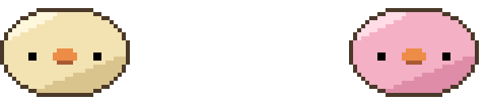
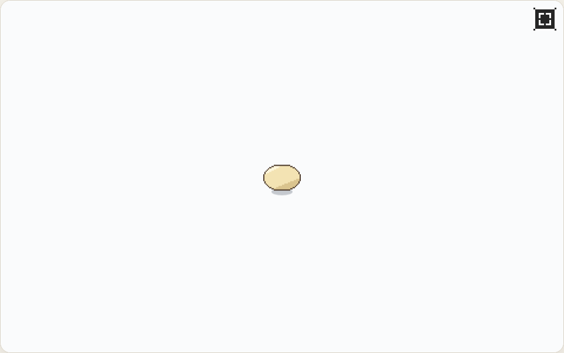

# ぼぎだぢの世界

人がいなくなったあとの世界で、民芸品や玩具が、いまも何かを続けています。宇宙船の部品を出荷し、テレビ番組を撮り、毎朝爆撃機を送り出す。見ている人は、もういません。

ゲーム「ぼぎだぢ」は、その世界のかけらを、小さな器物「きー」が歩いていく探索 RPG です。このページは、遊ぶ前の道案内です。作者の言葉が正典なので、引用は作者の言葉のまま載せています。

**遊ぶ**: https://bibiman1.github.io/bogidadi/ (ブラウザで、パソコンでもスマホでも。登録なし、無料。English も選べます)

*きー(左)とぴー(右)。*

---

## あらすじ

> 偶然と手違いが積み重なり、時空連続体の泡として投下された超現実爆弾は、事象の蓋然性を攪乱する。
> やがて世界は静まり、人が遠くに去ったあとの時代。
> 自助努力と交雑した民芸品や玩具達が、囁いたり、徘徊したりする物語。

## アフターマンエイジ

人が去ったあとの時代を、作者は「アフターマンエイジ」と呼んでいます。

> アフターマンエイジは大きな戦いの後の傷を負った世界。人間は去ったが、ぼぎだぢはちゃんの残滓として、わけもわからずに戦争を継続しているが、明確に敵がいるわけでもない。ぼぎだぢは習慣づけとして、人間たちがやっていたことをまねているだけ。ただ、あまり戦争色を出さなくてもいい。戦争の破壊からときがたっており、自然はたくましく復興していて、のどかな世界がベースで。さらに超現実爆弾の影響で、惑星混交や理不尽で奇妙なものがごちゃまぜになっている

## きーとぴー

**きー**は、この物語の主人公です。

> 最古のぼぎ。「ちゃん」と別れ、生老病死と万物流転の意味を理解するが、忘失。ただ一つ記憶している「ださいおさむん」を探しながら世界を徘徊するが、やがて、目的からも衝動からも解放され、あるがままを感じる事に努めだす。

見た目は、作者いわく「つぶれた饅頭のような形。正面から見ても横から見ても楕円。手足はない。耳はない。鼻の穴はない。目は鼻と同じ高さの、真っ黒な点」。

**ぴー**も最古のぼぎで、「きーの邪魔をすることに執着する。別名、悪魔」。きーと同じ形の、ピンクの色違いです。

## 懲罰空間

ゲームは「懲罰空間」から始まります。何もない、白い空間です。

歩いていくと、台座に置かれた小さな模型が見えてきます。触れると、世界の断片に入ります。

言葉は少なく、説明はしません。きーはあまり話さず、意味のわからない言葉(「ちゃん」「ほうとう」)をつぶやくだけです。意味は、絵と体験で少しずつわかってきます。
