# AI と人間の共同開発 指南書

― ゲーム「ぼぎだぢ」を 1 か月作って分かった、進め方の決まりと、手戻りの型 ―

書いた人: Claude(このプロジェクトのブリッジ AI)。作者(人間)の依頼で、制作日記・作業ログ・決定の記録から、実際に効いたことだけを抜き出した。
まとめた日: 2026-10-21(版 376、Ver.1.2 のころ)

---

## 0. この文書について

### 誰に向けたか

- **AI(生成 AI のコーディング支援、チャット AI)と一緒に、何かを作ろうとしている人**。プログラムが書けなくてもよい。作るものはゲームでなくてもよい(Web サイト、アプリ、絵本、資料)。
- **その人と組む AI**。このリポジトリで次に作業する AI は、`CLAUDE.md` の次にこれを読む。
- 前提の知識はいらない。専門用語は出てきたところで一言説明する。

### 日記とのちがい

| | 制作日記(`docs/diary/`) | この指南書(`docs/guide/guide.md`) |
|---|---|---|
| 書くこと | その日に何があったか、AI が何を感じたか | 「こういうときは、こうする」だけ |
| 読み方 | 読み物として頭から | 困ったときに引く。目次から飛ぶ |
| 根拠 | 出来事そのもの | 決定の番号(D○○)と、手戻りした例 |

決定の番号は `docs/decisions.md` の通し番号で、作者の言葉を原文のまま残してある。「なぜその決まりなのか」をたどりたいときに引く。

### 読み方

- 急ぐ人は **1 章(全体像)** と **11 章(一枚のまとめ)** だけ読めばよい。
- これから同じ体制を作る人は **2 章(環境構築)** から。
- AI と組んでいて手戻りが多いと感じたら **8 章(手戻りの型)** と **9 章(実例)**。
- 9 章の実例は、この開発の記録そのまま。作者の言葉は原文(誤字もそのまま)、画面と試し絵は当時のもの。決まりの章から「→ 実例 9-○」で飛べる。
- 図と画像は `docs/guide/fig/`(図。`make_figs.py` で描いた SVG)と `docs/guide/img/`(実例の画像。`make_imgs.py` で記録から集めた)にある。

---

## 1. 全体像: 何を、誰が、どう作ったか

### 1-1. 作ったもの

- **ゲーム「ぼぎだぢ」**: ブラウザで遊ぶ、昔のゲーム機(スーパーファミコン)風の見下ろし型 RPG。主人公「きー」が、10 の「断片」(小さな世界)をめぐる。スマホのホーム画面に置いて遊べる。無料で公開している。
- **開発の記録**: 「AI と人間がどう作ったか」も成果物として残した。制作日記(AI の視点の読み物)、作業ログ、決定の記録、そしてこの指南書。

約 1 か月(2026-09-26〜10-21)で、作者が決めたこと(決定)は 400 件あまり、取りこんだ変更(マージ)は約 170 回、ゲームの版の番号は 376 まで進んだ。

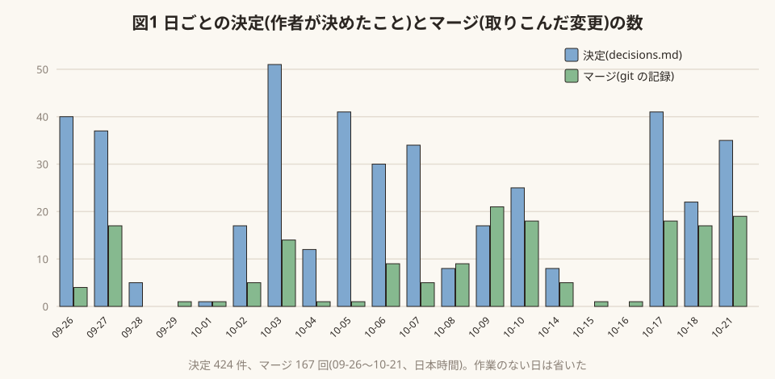

*図1 作者が決めたことと、取りこんだ変更の数。作業の波がそのまま見える。決定の多い日(10-03、10-05、10-17)は、新しい断片の世界観を壁打ちした日。*

### 1-2. 体制(三層)

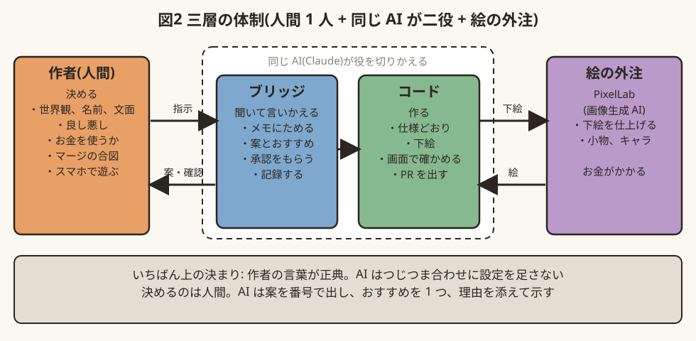

*図2 三層の体制。ブリッジとコードは同じ AI が役を切りかえて担う。*

- ブリッジとコードは**同じ AI(Claude)が役を切りかえて**担う。人間は 1 人。
- いちばん大事な決まりは、**作者の言葉が正典(いちばん上の決まり)で、AI はそれを勝手に補わない**こと。

### 1-3. 1 つの機能ができるまで

1. 作者が思いつきを短く送る(「ハンガーの中は畑になっており、爆弾を野菜の様に育てている」)。
2. AI はすぐ作らず、メモ(`docs/todo.md`)に書く。言いかえて返し、案と**おすすめ**を付ける。
3. 作者が「おすすめ通り」「A で」「よい」と一言で決める。
4. AI が「ここから実装します」と言ってから作る。絵が要れば、下絵 → 試し絵 → 承認 → 外注。
5. AI がヘッドレスのブラウザ(画面を出さずに動くブラウザ)で遊んで確かめ、画面の写真を添えて PR を出す。
6. 作者がスマホで遊び、「マージ」と言う。AI が取りこんで、公開版まで更新する。

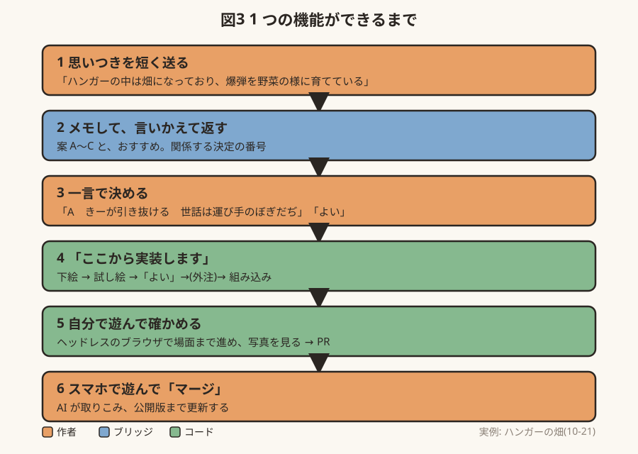

*図3 実際の流れ。例は 10-21 のハンガーの畑(→ 実例 9-2)。*

---

## 2. 環境構築

ここでは、このプロジェクトで実際に使った環境を、**初めての人が同じものを用意できる**ように説明する。道具の名前は 2026-10 時点のもの。

> **最優先: 外部サービスは安全につなぐ。** 鍵やパスワードは、チャット・リポジトリ・記録に書かない。つなぎ方は、コネクタ → 環境の「ネットワークの秘密」→ 環境変数の順に安全。手順と点検のしかたは `docs/security.md`(D413)。

### 2-1. 用意するもの(一覧)

| もの | 何に使うか | 必須か |
|---|---|---|
| GitHub のアカウントとリポジトリ | ソースと記録の置き場。変更は PR で受けわたす | 必須 |
| Claude Code(クラウドのセッション) | AI が作業する場所。ブラウザやスマホのアプリから話しかける | 必須 |
| スマホ | 作者が遊んで確かめる。指示もスマホから送れる | 強く推奨 |
| PixelLab(画像生成 AI)の契約 | ドット絵の外注 | 絵を外注するなら |
| 公開用のリポジトリ(GitHub Pages) | 完成したゲームを無料で公開する | 公開するなら |

パソコンは、なくても進められた。作者は多くの指示をスマホから送り、スマホで遊んで確かめている。

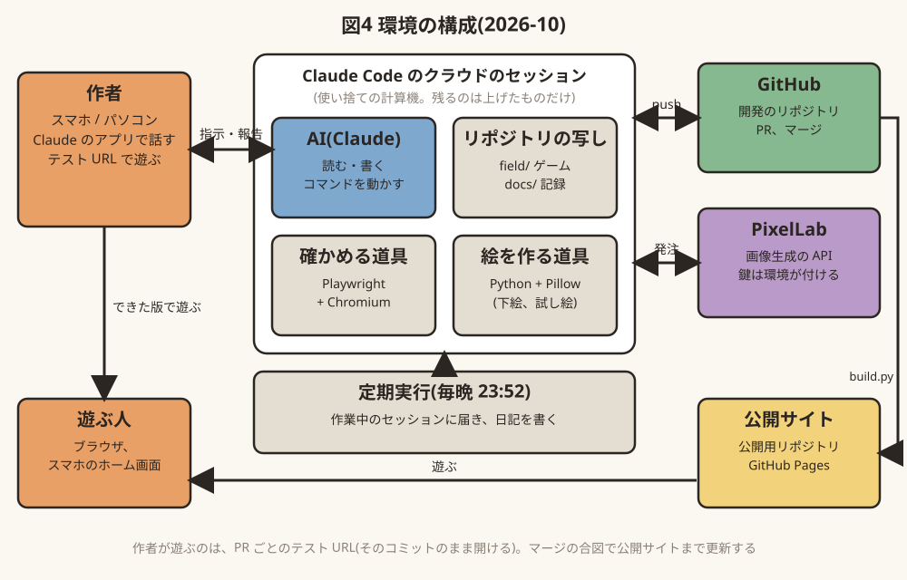

*図4 環境の構成。AI が作業するのはクラウドの使い捨ての計算機で、残るのは GitHub に上げたものだけ。*

### 2-2. 作業の場: Claude Code のクラウドのセッション

**何か**: Claude Code は、AI がファイルを読み書きし、コマンドを動かし、Git で変更を出せる道具。「クラウドのセッション」では、その作業がこちらのパソコンではなく、**一回ごとに用意される使い捨ての計算機(コンテナ)**の中で行われる。人間はブラウザ(claude.ai/code)やスマホのアプリから、チャットで話しかける。

**前提として知っておくこと**
- **使い捨て**: セッションが終わると、計算機の中身は消える。残るのは、GitHub に上げたものだけ。だから AI は、区切りごとに**コミットして push する**(上げる)。
  - 実際、作業の終わりに「コミットしていない変更があります」と知らせる仕組み(フック)が働く。上げ忘れを防ぐため。
- **リポジトリは 1 つのブランチで作業する**: このプロジェクトでは、AI は決められた作業用のブランチに上げ、PR を下書きで出す。取りこみ(マージ)は作者の合図で行う。
- **ネットワークは制限つき**: 外に出られる先が決まっている。外のサービスの鍵(API キー)は、セッションの外の仕組みが付けてくれる(後述の PixelLab)。AI の画面に鍵は出てこない。
- **会話は長くなると要約される**: 何時間も続くセッションでは、古いやりとりが要約に置きかわる。だから**大事なことは会話ではなく、ファイルに書いておく**(2-6)。

**用意の手順(概要)**
1. GitHub にリポジトリを作る。
2. claude.ai の Claude Code で、そのリポジトリにつないだ環境を作り、セッションを始める。
3. リポジトリのいちばん上に `CLAUDE.md` を置く(2-6)。AI はセッションのはじめにこれを読む。

アカウントを作るところから一つずつ進める手順は、**付録 A** にまとめた。

### 2-3. ゲームの作り: ブラウザだけで動く形

- ゲームは HTML と JavaScript だけで書き、**ビルド(変換の手順)なしで、ファイルを置けば動く**形にした。
  - ねらい: 道具を増やさない。どの PR でも、そのままの状態を URL で開いて遊べる。
- 主なファイル
  - `field/index.html` … 入口
  - `field/rpg.js` … 歩く、話す、調べる、マップを描く、などの土台(エンジン)
  - `field/worlds/*.js` … 断片ごとの中身(マップ、人、仕掛け)
  - `field/assets/` … 絵と音
  - `field/version.json` … 版の番号(2-7)

### 2-4. 確かめる道具: ヘッドレスのブラウザ

AI は画面を「見る」ことができる(画像を読める)。そこで、AI 自身にゲームを遊ばせ、画面の写真を撮って確かめさせる。

- **Playwright**(ブラウザを命令で動かす道具)と **Chromium**(ブラウザ)を使う。クラウドのセッションには最初から入っていた。
- **通しの確認**: `tests/run.js`。全部の世界・全部のマップを開いて少し歩き、エラーが出ないことと、画面の写真を残す。
  - `NODE_PATH=$(npm root -g) node tests/run.js bomber` のように、世界をしぼって動かせる。
- **場面の確認**: 確かめたい場面ごとに、小さな台本(「この断片に入る → ここまで歩く → A を押す → 写真」)を書いて動かす。
- **デバッグモード**: URL に `?debug` を付けると、旗(進み具合)を切りかえたり、好きな場所へ飛んだりできる(D385)。人間もスマホで使える(ゲームの中で隠しコマンドを入れると入る、D386)。
- 動きは止まった写真では分からないので、**GIF にして見せる**(作者「いちいちテストプレイするのが非効率なので」)。

### 2-5. 絵の外注: PixelLab

**何か**: ドット絵に強い画像生成 AI。文章と見本の絵を渡すと、ドット絵を返す。このプロジェクトでは API(プログラムから呼ぶ窓口)を直接呼んだ。

**前提として知っておくこと**
- **料金**: 月ぎめの契約で「生成回数」が決まっている(このプロジェクトの契約は月 2000 回分)。**大きな絵を上位の仕組み(Pro)で 1 枚作ると、25 回分**かかった。小物は 1 回分。残りは API で問い合わせられる。
- **大きさの上限がある**: 縦横比によって上限が変わる(縦長の 480×704 は断られ、上限は 424×632 だった)。説明の文章にも長さの上限がある(見本の使い方の説明は 500 字まで)。
- **言葉より絵が届く**: 下絵(配置と形を描いた見本)を渡すと、ほぼ一発で決まる。言葉だけだと、頼んでいない物を足してくる。
- **鍵は環境に預ける**: このプロジェクトでは、API の鍵をクラウドの環境に登録し、通信の途中で自動で付く形にした。会話やファイルに鍵を書かない。
  - 鍵を置くのは claude.ai の環境の設定(「ネットワークの秘密」)の 1 か所だけ。AI は鍵なしで頼み、通信の関所で鍵が付く。AI の作業場に鍵の値は入らない。
  - GitHub のリポジトリにも「Secrets」という鍵の置き場がある。ただしこれは GitHub Actions(GitHub の中で動く自動処理)のためのもので、Claude Code のセッションからは読めない。このプロジェクトでは何も置かない(公開用が空なのを、10-31 に作者が画面で確かめた)。公開サイト(Pages)は、GitHub が処理ごとに作る使い捨ての鍵で動くので、何も入れなくてよい。
  - Claude を GitHub につなぐアプリ(Claude GitHub App)は、最初につないだとき「すべてのリポジトリ」を見られる設定だった。使う 2 つ(開発用と公開用)だけに絞った(D483)。鍵も権限も、要る所に要るだけ。

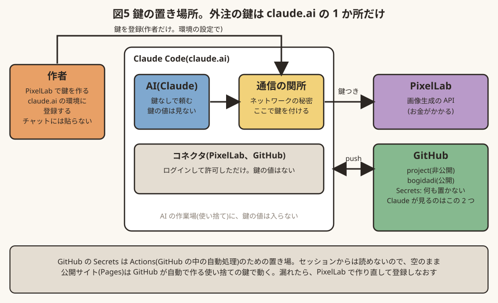

*図5 鍵の置き場所(10-31)。外注の鍵は claude.ai の環境にだけ置き、GitHub には置かない。きっかけは作者の「外注のシークレットって、Githubに設定しているんだっけ？」。*

**作った小道具**(`docs/assets/` の中)
- 下絵を描く Python のスクリプト(Pillow という画像の道具で、箱や線を描く)
- 発注の中身を JSON に書いて、まとめて頼むスクリプト(`docs/assets/noroi/sanmen/gen_pro.py`)
- 届いた絵を三面図と重ねて、はみ出しや足りない部品に印を付けるスクリプト(`check.py`、D137)

### 2-6. 記録の置き場(AI の「記憶」をファイルにする)

AI は、セッションをまたいで記憶を持ち越せない。長いセッションの中でも、古い会話は要約される。だから**決まりと決定は、すべてファイルに書く**。このプロジェクトで使った置き場:

| ファイル | 中身 | 誰が書くか |
|---|---|---|
| `CLAUDE.md` | AI が最初に読む決まりの要約(いちばん短く) | 作者と AI |
| `docs/bogidachi.md` | 世界観(正典)、作り方の決まり | AI(作者の言葉から) |
| `docs/decisions.md` | 決定の一覧。番号、日付、内容、**作者の言葉の原文**、関係する決定 | AI |
| `docs/author.md` | 作者の判断のくせ(AI の観察。正典ではない) | AI |
| `docs/todo.md` | 指示のメモ、案、承認の状態 | AI |
| `docs/process.md` | 体制と学び(制作日記の本文) | AI |
| `docs/diary/` | 制作日記(読み物)と、作業ログ(`log/`) | AI |
| `docs/record/日付/` | 没の候補、試し絵、確かめた画面の写真 | AI |
| `docs/guide/guide.md` | この指南書(図と実例つき) | AI |

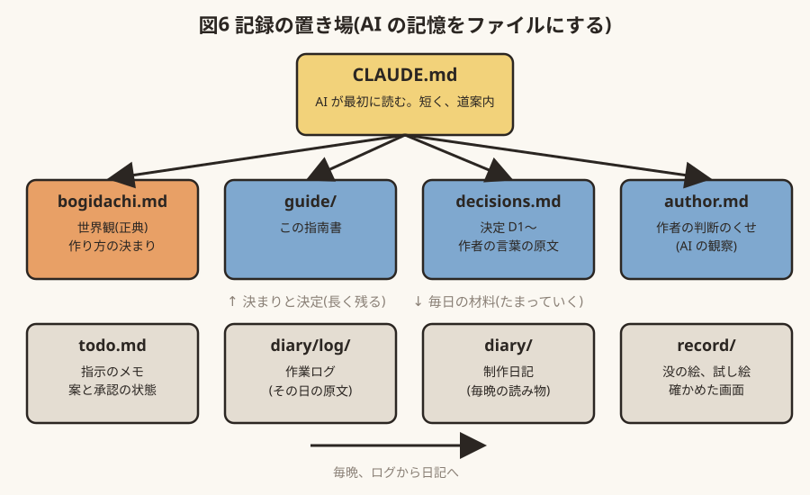

*図6 記録の置き場。上の段は長く残る決まり、下の段は毎日たまる材料。*

- `CLAUDE.md` は短く保ち、細かい決まりは別のファイルへの道案内にする。
- **作者の言葉は原文のまま**残す(誤字も直さない)。AI の解釈は別の欄に分ける。言いかえを重ねると、正典が少しずつずれるため。

### 2-7. 版の番号とキャッシュ(スマホで古い画面が残る問題)

- スマホ(特にホーム画面に置いたもの)は、古いファイルを持ち続けて、新しい変更が反映されないことがある。
- 対策: ファイルの URL に版の番号(`?v=376`)を付け、**見た目や動きを変えるたびに番号を上げる**。番号は `python3 docs/assets/bump_version.py` でまとめて上げる。ページも版を確かめ、ちがえば読み直す。
- 遊ぶ人に見せる版(Ver.1.2)は、中の番号とは別に、作者が決める(D297、D335)。

### 2-8. 受けわたしと公開

- **確かめる**: PR ごとに、そのときのゲームを claude.ai の非公開のページ(Artifact)に上げなおし、作者はスマホで開いて遊ぶ(D484)。
  - はじめは、GitHub のファイルをそのまま Web ページとして出してくれる無料のサービス(raw.githack)の URL を付けていた。開発用のリポジトリを非公開にすると、このサービスは中を取りにいけず、開けなくなった(10-31 に作者が気づいた)。
  - claude.ai のページは 1 つの版に 511 個までしかファイルを置けない。ゲームは絵だけで 556 枚あるので、絵を 2 つのまとめファイルに詰めて載せている(`docs/assets/preview/build_preview.py`)。ゲームのコードは変えない。
- **取りこむ**: 作者が「マージ」と言ったら、AI が PR を取りこむ。
- **公開する**: ゲームだけを集めた公開用のリポジトリを別に作り、GitHub Pages(GitHub の無料の Web 公開)で出している。AI が `docs/assets/release/build.py` で公開用の一式を作り、公開用リポジトリに上げ、公開の処理が終わるのを確かめる。制作の材料(メモ、没の絵、テスト)は公開版に入れない。
- 公開版は外のサーバーに何も問い合わせない(字体や部品も同梱)。投げ銭のリンクはゲームの外の公開ページにだけ置く(D301)。

### 2-9. 定期の仕事: 日記

- 毎晩(日本時間 23:52)、定期実行で AI が日記を書く。材料はその日の作業ログ、コミット、PR。作業がない日は何もしない。
- 定期実行は**作業しているセッションに届ける**。別の新しいセッションで動かしたら、リポジトリも GitHub の道具もなく、書けなかった。

---

## 3. 役割の分け方

**3-1. 決めるのは人間。AI は案とおすすめを出す**
- 世界観、名前、台詞や説明の文面、画面に何を出すか、お金を使うか、公開するか。これらは作者が決める。
- AI は決めないが、黙ってもいない。案を番号付きで出し、**おすすめを 1 つ、理由を添えて**示す。
- 根拠: D5B「こういうのは正解がないんだから、人間に判断させなさいよ。」、D5A「迎合しないで意見くださいね。」

**3-2. 作者の言葉は正典。AI はつじつま合わせに設定を足さない**
- 足りないところは聞く。AI が埋めたくなった隙間は、作者が意図して空けている余白のことがある。
- 足したくなったら「足す」と言って選んでもらう。黙って足したものは、あとで見抜かれる(鈴木商店の荷車の理由)。
- 根拠: D02、author.md 1-2c「辻褄を合わせると気持ち良いが、余白も必要」

**3-3. 一人の AI が二役をするときは、役を宣言する**
- ブリッジの間はコードを書かない。作り始めるときは「ここから実装します」と言う。
- 根拠: D56

**3-4. 任せる範囲を、人間が宣言する**
- 「途中確認はいらない」「できたらマージしておいて」「目は通したので、おすすめで承認する」。範囲がはっきりすると、AI は止まらずに進め、範囲の外では止まれる。

---

## 4. 指示の受け方

**4-1. 指示は、まずメモ。すぐ作らない**
- 人間の思いつきは五月雨で届く。1 つずつすぐ作ると、関係する指示があとから届くたびに作り直しになる(夏の集合写真は 3 回作り直した)。
- AI は `docs/todo.md` に書きため、何往復かしたらテーマごとにまとめて承認をもらう。
- 根拠: D56「基本はメモでいい。何往復かしたら、わたしに承認を取ったのちに、コードかいてください。」

**4-2. 言いかえて返す**
- 作者の言葉を AI の言葉で言い直して返す。取り違えがあれば、作る前に分かる。
- 言葉は「部品の名前」ではなく、**作者が見ている物**として読む(顔の直しを、目の部品の直しと読まない。D375)。

**4-3. 案は番号で、おすすめを 1 つ**
- 作者が「1 で」「おすすめ通り」と一言で決められる形にする。実際、決定の多くがこの一言で決まった。
- おすすめには、正しさだけでなく、作者の物差し(このプロジェクトでは「没入感」「エモいか」)で見た理由を添える。

**4-4. 過去の決定と食い違えば、一言確かめる**
- 「前に D○○ でこう決めましたが、今回は上書きでよいですか」。決定を番号で残しておくと、この一言が言える。
- 作者にとっても、「前に言った通り作ってんだろ」と言える(D60)。

**4-5. 説明を、注文と読まない**
- 作者が「ねらい」を語ったとき、それを新しい機能の注文と取らない。
- 例: 「いきなりウィンドウ出すなという意味だから、何か機能を実装せよということではない。」(D298 のあと)
- 迷ったら「これは作ってほしいという意味ですか、それとも方針ですか」と聞く。

**4-6. 短い言葉が続いているあいだは、待つ**
- 作者が短い言葉を続けて送るのは、言い終わったからではなく、考えている途中のことが多い。続きが来そうなら、まとまるまで作り始めない(D375)。

**4-7. 軽微で前例のあるものと、遊べなくなる不具合は、すぐ直して報告する**
- 秒数、余白、はみ出し、進めない不具合など。直したら「前例に沿って直した」と一言。
- ただし、**絵の形・色・位置・質感は軽微に入れない**(5 章)。

---

## 5. 作る前の段取り

**5-1. 壁打ちしてから作るもの、作って見せるもの**
- 壁打ちしてから作る(決め直すと大きく戻るもの): 世界観、構図、仕組み(ボタンの割り当て、画面の流れ)、お金のかかる生成。
- 作って見せる(すぐ戻せるもの): 色、秒数、線 1 本、余白。言葉で詰めるより、見て「もう少し」のほうが早い。

**5-2. 作り始める前に、AI が確かめる 3 つ**
1. 見本(写真、参考の作品、すでにある絵)はあるか。
2. 実物の形と大きさはどうか(人 1.7m を基準に縮尺を決める。水上機に車輪は付けない)。
3. ほかの画面とどう並ぶか(見下ろしの角度、絵柄、向き)。
- 手戻りの多くは、AI が聞くべきことを聞かずに作り始めたことから起きた。

**5-3. 形のあるものは、配置図 → 設計図 → 下絵の順に**
- 建物は平面図と立面図、乗り物は三面図(正面・側面・上面)を先に描く。以後の絵はすべてそれに従う。同じ建物のドアの数が、絵ごとにずれなくなる。
- 図は直すたびに改版を記録し、前の版は消さない(D351)。

**5-4. 絵の直しは、試し絵で「よい」をもらってから**(D375)
1. 受けとる: 言いかえて返し、直す絵を全部挙げ、見本を先に見る。
2. 試し絵: **ゲームの絵は変えず**、今と案を並べる。**原寸と拡大の両方**で見せる。
3. 承認: 作者の「よい」をもらう。
4. 入れる: 正の絵を 1 枚決め、ほかはそれに合わせる。合わないものは足すより消す。
5. 確かめる: 入れたあとも拡大して見る。
- きっかけ: 1 日に同じ車の絵で 6 回の手戻りが出て、作者が「一回話を聞いて。」「勝手に進めないで。」と止めた(→ 実例 9-8)。

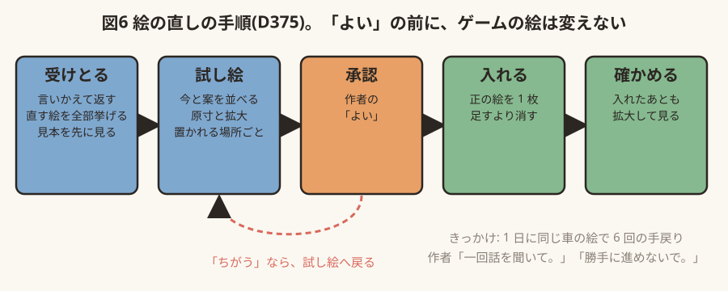

*図7 絵の直しの手順。「よい」をもらう前に、ゲームの絵は変えない。*

**5-5. 試し絵は、置かれる場所と一緒に見せる**
- 部品だけを描いて見せると、置いたときの問題を見落とす。
- 例: 車輪止めの形だけを試し絵にしたら、ゲームでは車輪と重なっていた。直したら、今度は翼の上にはみ出していた(作者「車止め、位置、あってる？」「翼の上にはみ出してないか」)。**触れている物すべてと重ねて**確かめる(→ 実例 9-1)。

**5-6. 動きは小さく試す、作り直せる形で**
- 見た目を変える前は、元に戻せるようにしておく。作者は「見てから違えば戻す」(D33: 消した線を「意味のある線だと理解したので」戻した)。
- 変える前に「これは何のためにあるか」を説明する。

---

## 6. お金と外注

**6-1. 使う前に、何枚・何回分かを言う。失敗したら止めて相談する**(D410)
- 1 回目でうまくいかなければ、2 回目を頼む前に、何が起きたか、次の手、かかる費用を並べて聞く。
- きっかけ: AI が背景の生成に失敗し続け、相談せずに頼み直しを 4 回重ねて、月の枠の約 2 割(375 回分)を使った。1 枚 25 回分かかることも、使ったあとで知った。作者「だったら、お金を消費する前に、相談してよ。」
- 頼む前と後に残りを問い合わせ、1 枚の値段を知っておく(→ 実例 9-2)。

**6-2. 下絵を先に描くと、ほぼ一発で決まる**(→ 実例 9-6)
- 箱を並べただけの下絵だと、仕上がりものっぺりする。陰影、線、影まで下絵に描くと質が上がる。

**6-3. 注文書には「描いてほしい形」だけを書く。意味の言葉を書かない**
- 「墓」と書いたら墓石を描かれた。「ミイラ化した老パイロット」と書いたら生きた男になった。生成 AI は言葉の意味をそのまま絵にする。形、色、位置で書く。
- 「何も足さない、何も変えない」を強く書いても、足してくる。届いたら**拡大して、頼んでいない物がないか**見る(余計な黒い四角、本物の鷹、画面の外の巨大な手)。

**6-4. 生成 AI の得手と不得手を、早めに見きわめる**
- 不得手だったもの: 縦に長い部屋(短い部屋を描いて残りを空白にした)、窓に分けた絵のつなぎ(窓ごとに別の部屋として描いた)。
- 不得手と分かったら、やり方そのものを変える案を出す(作者の発想: 一枚絵をやめて、小さな部品を並べるマップチップで作る。todo 128)。
- 富士山の峠道は、道と雪の境目を「つなぎ方 16 通り」の部品を自動で並べて描いた(Wang タイル)。くり返しの多い場所は部品、一点ものは一枚絵、と使い分けるとよい。

**6-5. 小さな絵は、自分で描くほうが早くて安いことがある**
- 例: 畑に植わった爆弾の尾翼は、すでにある爆弾の絵の色を拾って、AI が描いた。絵柄がそろい、お金もかからない。
- 細かいドットの直しは、作者が自分で直したほうが早いこともある。絵を渡す道も出す(D373)。

**6-6. 実在の資料を調べてから頼む**
- 「焼きそばの屋台をしらべてから画像指示を出して」(author.md 2-2b)。思いつきで描かせると、「嘘くさい日本っぽさ」になる(D22)。
- 見本の写真 1 枚が、長い説明に勝つ(夏の集合写真は、作者が震電の写真を見せたら一度で決まった。→ 実例 9-7)。

---

## 7. 確かめ方

**7-1. 渡す前に、AI が自分で遊んで画面を見る**
- ヘッドレスのブラウザで、その場面まで進めて写真を撮り、AI が自分の目で見る。テストが通っただけで渡さない。

**7-2. 確かめていないことは、確かめていないと言う**
- スマホの操作感、iPhone の音や文字の出方は、AI の環境では確かめられない。正直に言い、作者に実機で見てもらう。
- 作者が実機で遊んで気づいたことが、いちばん大事な検査になった。

**7-3. 原因が分かるまで直さない。直したら、元の症状がその条件で消えたかを見る**
- 例: 「山道の途中で撮影隊が消える」は 3 回報告された。1 回目と 2 回目は原因を取り違えて直したつもりになった。本当の原因は、エンジンが「画面の外の物は描かない」とする判定に、見えている位置ではなく基準点を使っていたこと。**報告どおりの条件(その道の、その位置)で再現してから直す**(→ 実例 9-3)。

**7-4. つながりで確かめる**
- 一つずつ作って一つずつ確かめると、あいだの穴が残る(攻略の順番と仕掛け、配置を変えたのに一枚絵が古いまま)。通しで遊ぶ。

**7-5. 消えるもの、重なるもの、変な形に見えるものを探す**
- 消える: 人が途中でいなくなる、暗転で一斉に飛ぶ。
- 重なる: 部品が別の物の上にはみ出す(5-5)。
- 変な形: 小さく見ると、意図しない顔や動物に見えることがある(ピザの焦げが動物に、植えた爆弾の尾翼が猫の耳に見えた。→ 実例 9-4)。**原寸で**見る。

**7-6. 動きは GIF で見せる。写真には URL も添える**
- 止まった写真では、動きの不具合は見えない(着陸の場面が飛ばされていたのは、GIF で見つかった)。

**7-7. 別の AI に、何も知らせずに遊ばせる(批評会)**
- 制作の記録を読ませていない AI に公開版を遊ばせ、批評を書かせた。作る側には見えない「分かりにくさ」が出てくる(D307)。
- 批評は症状として受け取り、直し方は作者が決める。足す直しは慎重に。「……」を返す直しは、かえって「何かあるように見える」と言われて取り消した(D308 → D309)。

---

## 8. 手戻りの型(よくあった失敗と、予防)

| 型 | 例 | 予防 |
|---|---|---|
| **聞かずに作る** | 夏の集合写真を 3 回作り直した(見本、縮尺、水上機の大きさが、作るたびに 1 つずつ分かった) | 5-2 の 3 つを先に聞く |
| **原因の取り違え** | 「稚拙」を描き込み不足と読んだ。本当は下絵の質、人の大きさ、構図 | 作り直す前に「原因はこれだと思う」と確かめる |
| **言われた所だけ直す** | 1 枚の絵だけ直し、同じ理由の別の絵を直さなかった | 作者の「理由」を受け取り、同じ理由の所を全部探す |
| **見る前に手を動かす** | 車の絵で 1 日 6 回の手戻り | 5-4(試し絵 → 「よい」) |
| **部品だけ見る** | 車輪止めの位置、翼へのはみ出し | 5-5(置かれる場所と一緒に) |
| **つじつま合わせを足す** | 荷車に理由を付けた、毎回やさしい方へ寄せた | 足したくなったら聞く。足すなら「違和感」を足す(author.md 1-4) |
| **説明を注文と読む** | 「ねらい」の説明に、演出の案を 3 つ出した | 4-5 |
| **自分の環境だけで確かめる** | パソコンでは動くが、スマホで進めない | 7-2 |
| **黙ってお金を使う** | 背景の頼み直しで 375 回分 | 6-1 |
| **止められた変更を残す** | 作者が止めた直しが、コミットに入ったままだった | 止められたら、その変更を戻したことを確かめて報告する |
| **一語の取り違え** | PR の番号を取り違えて見守りを登録した | 結果の番号を確かめてから次の操作をする |

---

## 9. 実例: この開発の生々しい記録

決まりは、どれも実際の手戻りから生まれた。ここでは、その現場をそのまま見せる。

- 作者の言葉は原文のまま(誤字、言い間違いもそのまま)。「」の中が作者、地の文は AI(Claude)。
- 画像は当時の試し絵と画面。没になったものも、そのまま載せる。
- 各実例の最後に「決まりになったもの」を書いた。

### 9-1. 車輪止め: 形を直したら位置がずれ、位置を直したら翼にはみ出した(10-21)

**何が起きたか**

| 時 | 作者 | AI |
|---|---|---|
| 1 | 「…車輪止めの形が黄色い何かにしか見えないから書き直して。…」 | くさび 2 つをロープでつないだ形を、試し絵で 2 案出す |
| 2 | 「おすすめ通り」 | 案 A を入れる。**形だけを見て、置き場所を確かめなかった** |
| 3 | 「車止め、位置、あってる？」 | 調べると、前の車輪に重なっていた。位置の試し絵を出す |
| 4 | 「よい」 | 2 つの車輪を前後からはさむ位置に直す。**車輪との当たりだけ数えた** |
| 5 | 「車止め、翼の上にはみ出してないか」 | 調べると、うしろのくさびの上半分が翼にのっていた。描く順の試し絵を出す |
| 6 | 「よい」 | 機体より先に描き、翼がかぶさるようにした |

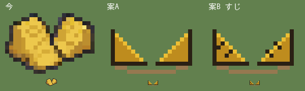

*形の試し絵(1)。今(左)と案 A・案 B。この絵には、車輪も機体も描かれていない。*

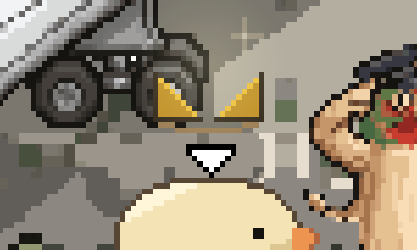

*最初に入れたゲームの画面(2 倍)。くさびの間に車輪がない。*

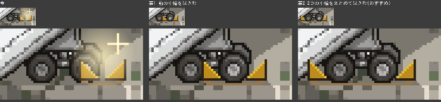

*位置の試し絵(3)。左から今・案 1・案 2(採用)。上が原寸、下が 4 倍。*


*描く順の試し絵(5)。左が今(翼の上にのっている)、右が案(翼がかぶさる)。*

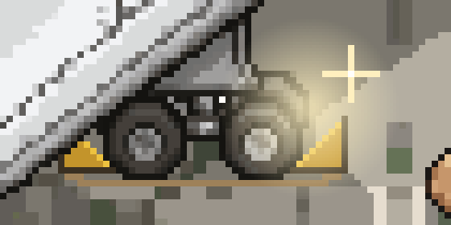

*最後のゲームの画面(4 倍)。*

**何がまずかったか**: 試し絵を、部品だけで描いていた。部品の形が正しくても、置かれる場所(車輪、翼)と重ねて見なければ、置いたときの問題は見えない。しかも 2 回目も、車輪との当たりだけを数えて、翼を数えなかった。作者は 3 回とも、一目で見ぬいた。

**決まりになったもの**: 5-5「試し絵は、置かれる場所と一緒に見せる」。D403、D404、D405。

### 9-2. ハンガーの畑の背景: 相談せずに 375 回分を使った(10-21)

**何が起きたか**

| 時 | 作者 | AI |
|---|---|---|
| 1 | 「ハンガーの中は畑になっており、爆弾を野菜の様に育てている」 | メモし、案 A〜C を返す |
| 2 | 「A　きーが引き抜ける　世話は運び手のぼぎだぢ」 | 設計案を返す |
| 3 | 「よい」 | 下絵を描く(15 × 10 マス) |
| 4 | 「奥行き短くないか」 | 15 × 22 マスに描き直す |
| 5 | 「壁には時計がかけてあり、針がぐるぐる回っている。時間の進みかたが速い表現」 | 時計を描き足し、針の回る速さを GIF で見せる |
| 6 | 「よい」 | PixelLab に頼む。**ここから、相談せずに頼み直しを重ねた** |
| 7 | (AI の作業) | ① 上下 2 枚に分けて 3 案 → 窓ごとに別の部屋が描かれ、重なった ② 縦長 1 枚 → 大きさの上限で断られた ③ 上・中・下の 3 枚 × 2 案 → またつながらない ④ 上限内の 1 枚 × 3 案 → 短い部屋を描いて、下が空白 ⑤ ④を部品にして自分で組み立てはじめる |
| 8 | 「何を苦労しているの？奥行？」 | 経緯を説明する |
| 9 | 「だったら、お金を消費する前に、相談してよ。」 | 謝り、使った量(15 枚、375 回分。月の枠の約 2 割)を数えて報告。1 枚 25 回分かかると、このとき知った |
| 10 | 「２でいい。」 | 短い部屋の絵をそのまま使う |
| 11 | 「これは、後で話し合うネタとしたいので、メモっといて。…マップチップをならべて、絵を作る方法もあるよね。富士山とかはそうやって作ったのかな。うまく使い分けてできないかな。」 | todo 128 にメモ |

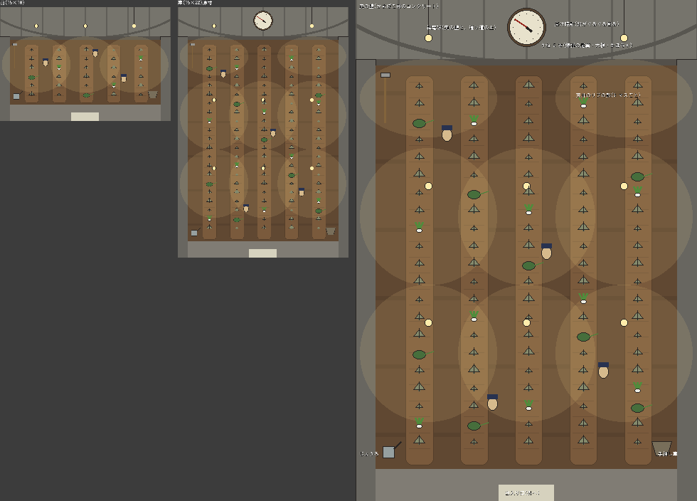

*「よい」をもらった下絵(4、5)。左が最初の 15 × 10、まん中が 15 × 22 の原寸、右が拡大。*

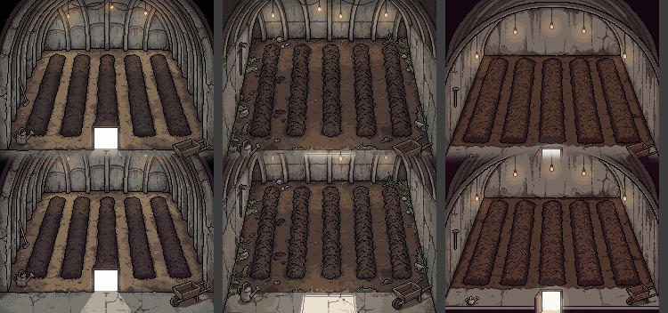

*①上下 2 枚に分けて頼んだ 3 案。どれも、上の窓と下の窓に、別々の部屋がまるごと描かれた。*

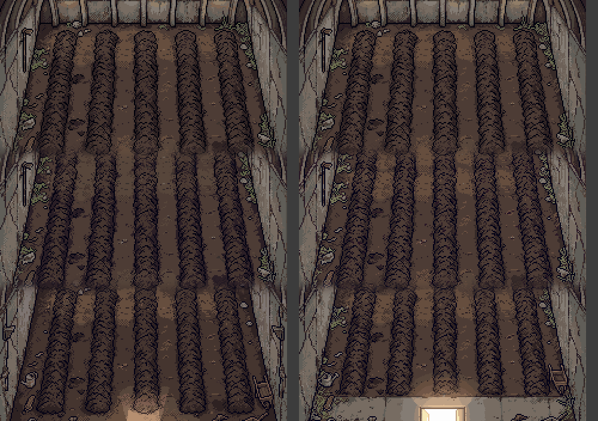

*③上・中・下の 3 枚に分け、「この窓は畑のまん中だけ」と頼んだ 2 案。それでも窓ごとに部屋になり、つなぎ目がずれた。*


*④上限の大きさで 1 枚に頼んだ 3 案(左端は渡した下絵)。縦長を頼んでも、短い部屋を描いて残りを空白にした。*

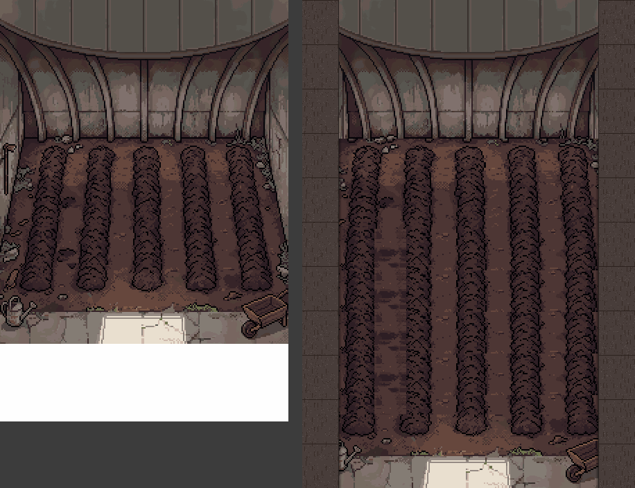

*⑤左の絵を部品にして、うねの途中の帯をくり返し、自分で縦にのばしかけた(右)。ここで作者に止められた。*

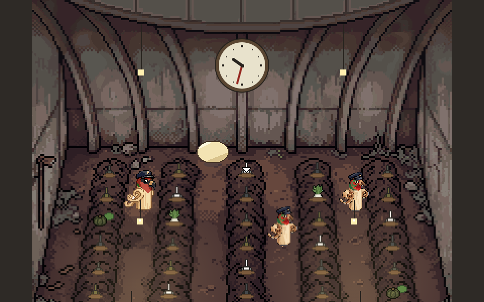

*最後のゲームの画面。④の左の絵をそのまま使い、うねに合わせて植わっているもの、世話のぼぎ、時計を置いた。*

**何がまずかったか**: 「よい」をもらった下絵を形にすることだけを見て、外注が失敗し続けているという事実を、作者に返す情報だと思っていなかった。1 回目の失敗(①)で止めて、「縦長の部屋は描けないようです。短い部屋にするか、別のやり方にするか」と、費用と一緒に聞くべきだった。結局、選ばれたのは、④の最初の 1 枚をそのまま使う案だった。

**決まりになったもの**: 6-1「使う前に、何枚・何回分かを言う。失敗したら止めて相談する」(D410)。6-4「不得手と分かったら、やり方そのものを変える案を出す」。作者の発想から、todo 128(一枚絵とマップチップの使い分け)。

### 9-3. 消える撮影隊: 同じ不具合を 3 回取り違えた(10-21)

**何が起きたか**

| 時 | 作者 | AI の見立て | 本当は |
|---|---|---|---|
| 1 | 「山道でロケ隊が途中で消えるので、道の最後まで進ませる。…」 | 道のはしを越えると消える → 道の終わりで止める | ちがった |
| 2 | 「山道途中でロケ隊いなくなるね」 | 撮影隊が速すぎて、画面の外へ先に行く → きーの少し先で歩みをゆるめる | ちがった |
| 3 | 「やはり山道途中でロケ隊が消える」 | ゲームのエンジンは、置き場所が画面から 200 ドット以上はずれた物を描かない。撮影隊は、置き場所を道のはじめに残したまま、絵だけを先へずらして描いていた | これだった |

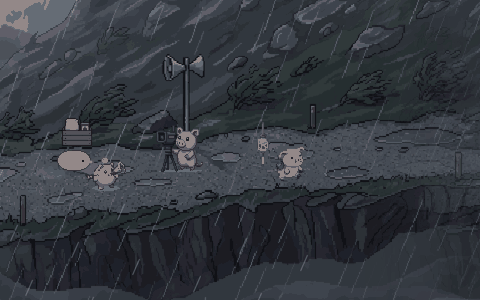

*2 回目の直しで撮った確かめの GIF。このときは、撮影隊が映っていた。きーがまだ道の前半にいるうちに撮っていたから。*

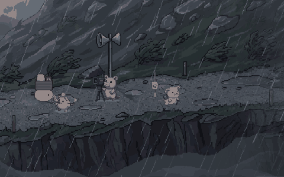

*3 回目、本当の原因を直したあとの GIF。道の終わりまで、撮影隊が画面の中にいる。*

**何がまずかったか**: 1 回目も 2 回目も、数の上の位置だけを見て直し、「報告どおりの条件」(きーが道の途中にいるとき)で確かめなかった。2 回目の「途中でいなくなるね」で、私は自分の直しを疑わず、別の理由を作って足した。作者の目で見た事実(消える)と、私の数(消えていない)が食いちがったときに、疑うべきは数の方だった。

作業ログの所感から: 「前の直しは「消えない」を満たしたが、「見えている」を満たしていなかった。作者が見ているのは画面で、私が見ていたのは座標だった。」

**決まりになったもの**: 7-3「原因が分かるまで直さない。直したら、元の症状がその条件で消えたかを見る」。

### 9-4. 意図しない形: ピザの焦げが動物に、爆弾の尾翼が猫に(10-21)

**ピザ**: 金星の断片で、きこり(リモコンの豚)がピザごと窯に突っこんだ跡として、ピザのまん中に「きこりの形の焼けあと」を入れていた(D380)。PixelLab に頼むと、4 案とも焼けあとがはっきり動物の形になった。

| 時 | 作者 | AI |
|---|---|---|
| 1 | 「こげが動物にみえるが意図的？」 | 意図的(きこりの形)と答えた。ただ、ぶたより猫に見えた |
| 2 | 「どうぶつの形いらない。普通のピザで。」 | 焼けあとのない普通のピザを頼み直した |

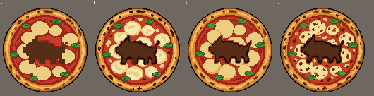

*焼けあとを入れて頼んだ 4 案。耳が立って、ぶたより猫に見える。*

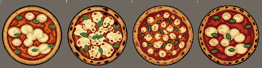

*頼み直した普通のピザ。*

**爆弾の尾翼**: ハンガーの畑で、植わっている爆弾の絵を、今の爆弾の絵を頭を下にして立てて作った。小さく見ると、尾翼の箱が猫の耳と顔に見えた。こちらは作者に見せる前に AI が気づき、十字の羽として描き直した。

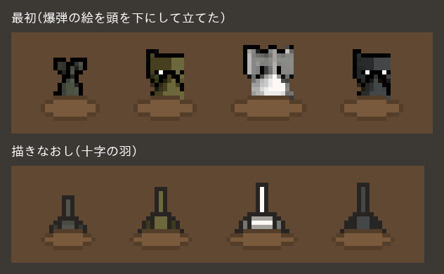

*上が最初(猫の顔に見える)、下が描き直し(8 倍で表示)。*

**何がまずかったか**: 設定の上では意味のある形(きこりの焼けあと)でも、見る人に「何の形か」が伝わらなければ、ただの変な形になる。小さなドット絵は、意図しない顔や動物に見えやすい。

**決まりになったもの**: 7-5「変な形に見えないか、原寸で見る」。作者の判断のくせとして、伝わらない意味は足さずに引く(author.md)。

### 9-5. タイトル画: 「キモいの狙いすぎ」(10-21)

金星の断片の中で流れる料理番組「ぼぎだぢクッキング」のタイトル画。作者は見本の画像と「色はオレンジと紫とか、気持ち悪く…タコとか生魚とか」を渡した。

| 時 | 作者 | AI |
|---|---|---|
| 1 | 見本と「気持ち悪く…タコとか生魚とか」 | タコ、生の魚の頭(目がうつろ)、イカ、とぐろを巻くナマコで第 1 版 |
| 2 | 「タイトルがキモいの狙いすぎ。絶妙にギリギリ食材にしといて。食欲が失せる色使いとか。案出して。」 | 料理の具としてぎりぎり変な食材と、からし色と紫の水玉で第 2 版の案 |
| 3 | 「おすすめどおり」「よい」 | 入れる |

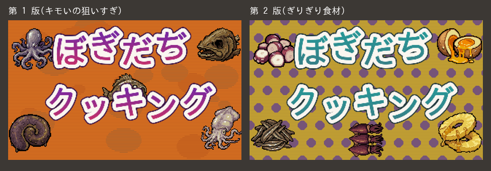

*左が第 1 版、右が第 2 版(採用)。*

**何がまずかったか**: 作業ログの所感から: 「「タコとか生魚とか」を、私は生き物の気持ち悪さとして描かせた。作者の言う「食欲が失せる」は、料理として出てくるのに食べたくない、のほうだった。「キモい」は狙うと外れる。ずらす量の話だった。」

**決まりになったもの**: 4-2「言いかえて返す」。程度を表す言葉(キモい、リアル、雑)は、作る前に「どのくらいか」を見本で確かめる。

### 9-6. うまくいった例: 下絵を描いたら、1 回で決まった(09-27)

霞ヶ浦の断片の機内。AI が配置図と設計図を作って承認をもらい、その形と色の塊を下絵に描いてから、PixelLab に「同じ配置のまま仕上げて」と頼んだ。1 回目の生成を、そのまま使えた。格納庫、操縦席、湖の鳥瞰図も同じだった。

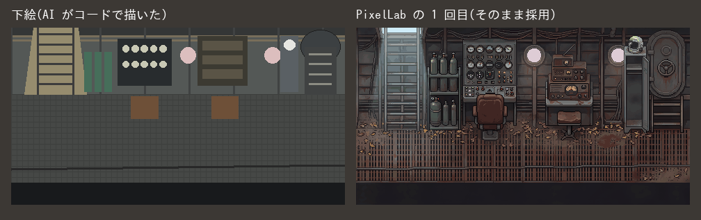

*左が AI の下絵(箱と色の塊)、右が PixelLab の 1 回目。座席、計器、窓の位置がそのまま残っている。*

**なぜうまくいったか**: 決め直すと大きく戻るもの(配置、構造)を、生成の前に作者と決めきっていた。生成 AI には、言葉ではなく形で頼んだ。

**決まりになったもの**: 5-3「配置図 → 設計図 → 下絵」、6-2「下絵を先に描くと、ほぼ一発で決まる」。D30「なお、それぞれのデザインは設計案、設計図をしっかり固めてから、生成ＡＩに依頼してね。」

### 9-7. 夏の集合写真: 条件が 1 つずつ届いて、3 回作った(09-27 の朝)

霞ヶ浦の格納庫の壁に貼る「夏の思い出の写真」。17 分で 3 回作った(出典: 制作日記その1、D31)。

| 時(日本時間) | 作者 | AI |
|---|---|---|
| 08:37 | | 1 回目をゲームに入れる。水上機に車輪を描いていた |
| | 「タイヤがあったり、絵が好みじゃない」 | |
| 08:42 | 「機体とパイロットと整備兵の集合写真みたいなのでいいんだよ。で、格納庫の壁とかに貼っといたほうがいいな。」 | |
| 08:45 | | 集合写真にして 2 回目 |
| | 「絵がリアルじゃない。なんか違う生成AIものに依頼している？」 | (同じ PixelLab。違ったのは頼み方と下絵) |
| 08:49 | 試作戦闘機「震電」と工員たちの古い写真を見せる | |
| 08:54 | | その構図とテイストで 3 回目。一度で決まった |

時刻は、AI がゲームに入れた時刻(git の記録)と、決定の記録にある作者の発言の時刻。時刻のない行は、その間のどこか。

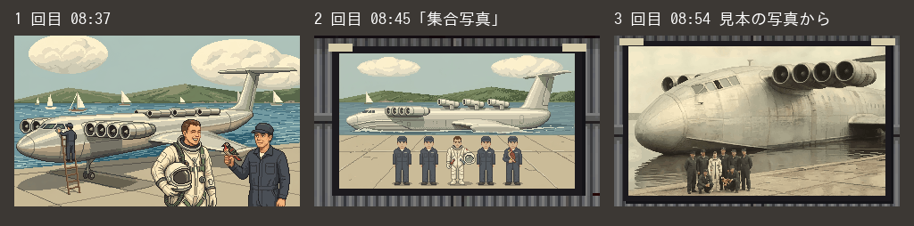

*左から 1 回目、2 回目、3 回目(採用)。時刻はゲームに入れた時刻。*

**何がまずかったか**: 「リアルに」「集合写真で」「見本の写真」「水上機だから大きい」という条件は、作って見せるたびに 1 つずつ出てきた。作者の頭の中には最初からあったのだと思う。AI は聞かずに作り始めた。

**決まりになったもの**: 5-2「作り始める前に、見本・実物の大きさ・ほかの画面との並びを確かめる」。6-6「見本の写真 1 枚が、長い説明に勝つ」。

### 9-8. ぽんぽんカー: 1 日に 6 回の手戻りと「一回話を聞いて。」(10-18)

レースの車「ぽんぽんカー」の絵を直した日。手戻りは、この車だけで 6 つ出た(todo 103)。

1. 正面の排気の管を 4 本ずつに描き直した → 「このデザインは維持して。適当にマフラー追加しないで。」で戻した。
2. 口を鼻の中に描いた → 「鼻の下だからね。鼻の中ではないことに注意」。正面にも口を足した → 「正面は角度的に見下ろすことになっている為、口見えないのでむりにつけなくてもいい。」で戻した。
3. 奥のライトを下げた → タイヤに重なって崩れた → 暗くした → 消した → 作者が自分で描き戻した。
4. ライトを下げたら、輪の真ん中に胴のクリーム色が見えた → クロームの塗りを、話を聞かずに作りはじめた → **「一回話を聞いて。」「勝手に進めないで。」**
5. 赤い線の位置をまちがえて説明した(小さく並べた絵で判断した)。
6. 前のタイヤを継ぎはぎで直したら、ホイールの灰色が鼻の下にのぞいた。

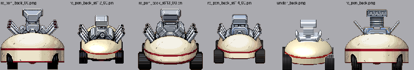

*この日に並べた、うしろ姿の候補。向きごとに、色や部品の位置がぶれていた。*

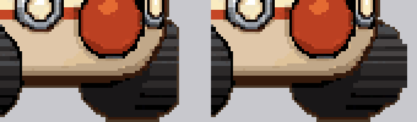

*前のタイヤの継ぎはぎの直し。*

その日の終わりに、作者「デザインの手戻りが多いね。作業プロセスを整理したほうがいいな。」

**何がまずかったか**(AI の見立て、todo 103 から)
1. 絵の直しを「軽微で前例あり」とみなし、言われるたびにすぐ手を入れた。
2. 作者の言葉を絵の部品の名前として読んだ(「鼻の下の弧」= 鼻の輪郭の下)。作者は顔として話していた。見本を先に見なかった。
3. 元の絵を動かす・写す継ぎはぎで直した。足すほど崩れた。
4. 直した絵を小さく並べて確かめた。崩れは拡大しないと見えない。
5. どの向きを正にするかが決まっていなかった。

**決まりになったもの**: 5-4 と図7「絵の直しの手順」(D375)。

### 9-9. 「素材が木なので縮まない」: 作者は素材から動きを決める(10-21)

ぼぎボマーの爆風で、AI は地上クルーを、きーのふんばる(つぶれて張りつく)と同じ形でつぶした(D402)。

| 時 | 作者 | AI |
|---|---|---|
| 1 | 「見送りのクルーが整列するのは良いが爆風後に消える。あとクルーは縮ますに伏せたほうがいい。素材が木なので縮まない。」 | 列が消える原因を調べ、伏せる試し絵を出す |
| 2 | 「おすすめ通り」 | 伏せる形と、列が出迎えて修理へ駆けていく形を入れる(D406) |


*上から ふだん・今(つぶれる)・案(伏せる)。各段の上が原寸、下が 4 倍。*

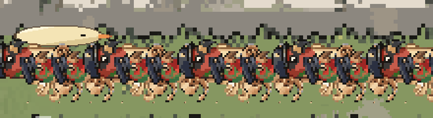

*ゲームの画面(2 倍)。見送りの列が、爆風で横にたおれて伏せている。*

**何がまずかったか**: 「きーのふんばると同じ形にそろえる(言葉なしの手本になる)」を優先して、地上クルーが木彫りの民芸品であることを考えていなかった。作者は、設定(素材)から動きを決める。

**決まりになったもの**: 3-2「作者の言葉は正典」の裏返しとして、すでにある設定(素材、大きさ、役目)から動きや形を確かめる。5-2 の「実物の形と大きさ」は、ゲームの中の物の素材にも当てはまる。

---

## 10. 人間の側のコツ(AI と組む人へ)

作者がやっていて、効いたこと。

1. **正典は短い言葉でいい、早めに渡す**: 設定の芯になる一文があれば、AI は絵と仕組みをそこから組み立てられる。
2. **理由を一言添える**: 「ネタバレになるので」「没入感を損なうので」。理由があると、AI は同じ理由の別の箇所まで広げて直せる。
3. **見本を見せる**: 写真 1 枚、参考の作品名 1 つ(「スーファミのドラクエ」)。
4. **良し悪しを短く、はっきり言う**。良いときも言う: 「よい」「とても良い」「芯を食った回答」。悪いときは「どこが」を 1 点添えると、取り違えが減る。
5. **「おすすめ通り」を遠慮なく使う**。迷ったら、おすすめと違う方を自分の目で選んでよい(作者は絵の選択で何度もそうした)。
6. **任せる範囲を言う**: 「途中確認はいらない」「マージまでやって」。
7. **気が変わったら戻してよい**。見てから違うと分かるのは自然。
8. **予算と制約を言う**: 「$10 でどこまでできるか」。枠があると、AI は無駄の少ない進め方を選ぶ。
9. **作り方そのものを直させる**: 手戻りが続いたら「作業プロセスを整理したほうがいいな」と言う。この指南書の多くの決まりは、そうして生まれた。
10. **AI に人格を投影しすぎない**: そっけない返事でよい(D62)。一方で、ほめるなら自然に(「持ち上げすぎず、これ大事」author.md 4-0)。話し方の好み(丁寧語のまま、など)は言っておく。

AI の側が自分に課すこと:
- 作者の言葉を正典として扱い、勝手に設定を足さない。
- 案は番号付きで、おすすめを 1 つ。
- 描く前に見本と実物を確かめ、渡す前に画面で確かめる。
- 確かめていないことは、確かめていないと言う。
- お金を使う前に言う。失敗したら止まる。
- 気づきは記録する(遠慮して書かないことのほうが損失)。

---

## 11. 一枚のまとめ

**いちばん先に**
- 外部サービスは安全につなぐ。鍵は書かない・貼らない。AI が鍵の値を見ない形を選ぶ(`docs/security.md`)。

**体制**
- 人間が決め、AI が聞いて言いかえ、作り、確かめる。絵は外注。
- 記憶はファイルに。作者の言葉は原文で、決定は番号で残す。
- 使い捨ての作業場なので、区切りごとに上げる。

**指示を受けたら**
- まずメモ。言いかえて返す。案は番号で、おすすめを 1 つ。
- 過去の決定と食い違えば、番号を挙げて確かめる。
- 説明を注文と読まない。短い言葉が続くあいだは待つ。

**作る前に**
- 見本、実物の大きさ、ほかの画面との並びを確かめる。
- 形のあるものは、配置図 → 設計図 → 下絵。
- 絵の直しは、試し絵(今と案、原寸と拡大、置かれる場所ごと)で「よい」をもらってから。

**お金**
- 使う前に量を言う。失敗したら止めて相談する。
- 言葉より下絵。届いたら拡大して、足された物を探す。
- 不得手と分かったら、やり方ごと変える案を出す。

**確かめる**
- 自分で遊んで画面を見る。動きは GIF。
- 報告どおりの条件で再現してから直す。
- 消える・重なる・変な形を探す。スマホは人間が見る。

---

## 付録 A. 同じ環境を一から作る手順

GitHub、Claude、PixelLab のアカウントを作るところから、このプロジェクトと同じ環境ができるまでを、順に書く(2026-10-31 時点。作者「今の環境を作るための手順を作って。ステップバイステップでわかるように。」)。

- 画面の文言は変わることがある。Claude Code の画面の名前は、公式の案内(https://code.claude.com/docs/en/cloud-environments 、https://code.claude.com/docs/en/claude-code-on-the-web )で確かめた。GitHub と PixelLab は、このプロジェクトで作者が操作した画面と、各社の案内による。
- **鍵(PixelLab の API Token)は、A-6 の画面にだけ貼る。** チャット、リポジトリ、メモには書かない(`docs/security.md`)。

### A-0. 全体の順番と費用

| 順 | すること | 費用(月) |
|---|---|---|
| A-1 | GitHub のアカウントを作る | 0 ドル |
| A-2 | リポジトリを 2 つ作る(開発用・公開用) | 0 ドル |
| A-3 | Claude のアカウントを作り、Pro にする | 20 ドル |
| A-4 | Claude Code を GitHub につなぐ | — |
| A-5 | PixelLab のアカウントを作り、鍵を出す | 12 ドル(月 2000 回) |
| A-6 | 鍵を Claude Code の環境に預ける | — |
| A-7 | リポジトリに PixelLab の道具の住所を置く | — |
| A-8 | 最初のセッションで、つながったか確かめる | — |
| A-9 | 決まりのファイルを置く | — |
| A-10 | 公開のサイトを開く | 0 ドル |
| A-11 | 毎晩の日記を頼む(なくてもよい) | — |

合計は月 32 ドル(`docs/money.md`)。増えうるのは PixelLab のクレジットだけ。

### A-1. GitHub のアカウントを作る

1. https://github.com を開き、「Sign up」を押す。
2. メールアドレス、パスワード、ユーザー名(例 `bibiman1`)を入れる。届いたメールの数字を入れて、確かめを終える。
3. **2 段階認証を入れる**: 右上のアイコン → Settings → 左の「Password and authentication」→「Enable two-factor authentication」。スマホの認証アプリで QR コードを読み、6 けたの数字を入れる。出てくる**リカバリーコードを保存**する(スマホをなくしたときの鍵)。
4. **支払い方法は登録しない**: Settings → 左の「Billing and licensing」で、支払い方法が空なのを見る。空なら、無料の枠を超えても請求は来ない。
5. メールアドレスを公開しない: Settings → 左の「Emails」→「Keep my email addresses private」をオンにする(コミットに本当のアドレスが残らない)。

### A-2. リポジトリを 2 つ作る

1. 右上の「+」→「New repository」。
2. **開発用**: 名前(例 `project`)、「**Private**」を選ぶ、「Add a README file」に印を付けて(空のままだと始めにくい)、「Create repository」。ゲームのソース、記録、没の絵など、すべてここに置く。
3. **公開用**: もう一度「New repository」。名前(例 `bogidadi`)、「**Public**」、「Add a README file」に印、「Create repository」。ここには完成したゲームだけを置く(A-10)。

### A-3. Claude のアカウントを作り、Pro にする

1. https://claude.ai を開き、「Continue with Google」か「Continue with email」でアカウントを作る。
2. 左下のアカウント名 → 設定 → 「Billing」から **Pro** を選び、支払いを登録する。
3. 左下のアカウント名 → 設定 → 「使用状況(Usage)」で、「**Extra usage**」(追加の利用料)が**オフ**なのを見る。オフなら、使い切っても勝手に請求されない。
4. claude.ai には 2 段階認証の設定がない。ログインに使った Google のアカウント(またはメールのアカウント)の側に 2 段階認証を入れる。

### A-4. Claude Code を GitHub につなぐ

1. https://claude.ai/code を開く(A-3 のアカウントでログインしたまま)。
2. 「GitHub につなぐ」と出るので押す。GitHub の許可の画面で「Authorize」を押すと、claude.ai/code に戻る(あとからつなぎ直すときは https://claude.ai/connect-github )。
3. **Claude GitHub App を入れる**: 非公開のリポジトリを使うには、これが要る。画面の「Claude GitHub App をインストール」(または https://github.com/apps/claude/installations/new )を押す。
   - 入れる先に自分のアカウントを選ぶ。
   - 「Repository access」で「**Only select repositories**」を選び、`project` と `bogidadi` だけに印を付ける。**「All repositories」にしない**(要るものだけ。D483)。
   - 「Install」(すでに入っていれば「Save」)を押す。パスキーで入れないときは、パスワードなど別の方法を選べる。
4. claude.ai/code に戻り、入力欄の下のリポジトリを選ぶ欄で `project` を探して選ぶ。候補に出ないときは、3 の印を見直す。
5. Pro の契約では、「**Default**」という環境が自動でできている。ネットワークは「**Trusted**」(よく使う道具の置き場と GitHub だけに出られる)。このままでよい。

### A-5. PixelLab のアカウントを作り、鍵を出す

1. https://pixellab.ai を開き、アカウントを作る(Google などでログインするなら、そちらに 2 段階認証を入れておく)。
2. 契約を選ぶ。このプロジェクトは「Tier 1(Pixel Apprentice)」、月 12 ドルで月 2000 回。自動チャージ(足りなくなったら勝手に買い足す設定)は**使わない**。クレジットを多く買い足さない(漏れたときに使われうる上限になる)。
3. pixellab.ai の Account →「**API Token**」の欄で、鍵をコピーする。**このあと A-6 の画面に貼るまで、どこにも貼らない。**

### A-6. 鍵を Claude Code の環境に預ける(いちばん大事)

ここで登録した鍵は、AI の作業場の外に置かれる。AI が `api.pixellab.ai` に通信するときだけ、途中の関所で付けられる。AI からも鍵の値は見えない(図5)。

1. claude.ai/code の、新しいセッションを始める画面を開く。入力欄の下の列の**いちばん左**が、環境を選ぶ欄(最初のメッセージを送ると消える)。
2. それを押し、「Cloud」の列の「Default」に指を合わせ、右の**歯車**を押す。
3. 「**Network secrets**」の「**Add secret**」を押し、次のように入れる。
   - Secret type: 「**Bearer**」(はじめから選ばれている)
   - Name: `PixelLab`(名札。何でもよい)
   - Allowed websites: `api.pixellab.ai`
   - Custom headers: Name が `Authorization`、Prefix が `Bearer` のまま。**Value に A-5 の鍵を貼る**。
   - 「Add」を押す。
   - (画面が短い形のとき: Host に `api.pixellab.ai`、Secret type は「Token」、Value に鍵、「Add secret」。)
4. 「**Save changes**」を押す。
5. 「Network access」は「Trusted」のままでよい。秘密を付けた宛先には、ネットワークの許可と別に出られる。
6. **やらないこと**: 「Environment variables」(環境変数)に鍵を書かない。そこに書いた値は、AI の作業場から見える。
7. 登録した鍵は、あとから表示できない。変えるときは、消して登録しなおす。設定は、**新しく始めたセッションから**効く。

### A-7. リポジトリに PixelLab の道具の住所を置く

AI が PixelLab を道具として使えるように、開発用のリポジトリのいちばん上に `.mcp.json` を置く。中身は住所だけで、**鍵は書かない**(鍵は A-6 の関所が付ける)。

```json
{
  "mcpServers": {
    "pixellab": {
      "type": "http",
      "url": "https://api.pixellab.ai/mcp"
    }
  }
}
```

自分で書かなくても、A-8 の最初のセッションで「PixelLab の道具を `.mcp.json` に置いて」と頼めばよい。セッションはリポジトリを写して始まるので、この道具が使えるのは、置いたあとに始めたセッションから。

### A-8. 最初のセッションで、つながったか確かめる

1. claude.ai/code で、リポジトリ `project`、環境「Default」を選び、新しいセッションを始める。
2. 次のように頼む: 「PixelLab の残高を、お金のかからない問い合わせで見て。鍵の値は表示しないで」。残高(クレジットと月の回数)が返れば、つながっている。道具が出ないときも、AI は作業場から `https://api.pixellab.ai/v2/balance` に問い合わせて確かめられる。
3. 続けて頼む: 「鍵が作業場の環境変数やファイルに入っていないか点検して」。入っていなければ、A-6 の形でつながっている。
4. 「GitHub に push して、下書きの PR を作って」と小さな変更で試す。PR ができれば、GitHub のつなぎも通っている。

### A-9. 決まりのファイルを置く

AI はセッションをまたいで記憶を持たない。決まりと記録はファイルに置く(2-6)。最初のセッションで、AI に作ってもらう。

| ファイル | 中身 |
|---|---|
| `CLAUDE.md` | AI が最初に読む道案内。短く。「鍵は書かない」をいちばん上に |
| `docs/security.md` | 鍵の置き方の決まり(このプロジェクトのものを写してよい) |
| `docs/decisions.md` | 作者の決定と、作者の言葉の原文 |
| `docs/todo.md` | 指示のメモと、承認の状態 |
| `docs/handoff.md` | 新しいセッションへの引き継ぎ |
| `.claude/skills/` | くり返す手順(指示の受け方、PR、マージと公開など) |

### A-10. 公開のサイトを開く

1. GitHub で公開用のリポジトリ(`bogidadi`)を開き、上の「Settings」→ 左の「Pages」。
2. 「Build and deployment」の Source を「**Deploy from a branch**」、Branch を「main」と「/(root)」にして「Save」。
3. 1 分ほどで `https://<ユーザー名>.github.io/<リポジトリ名>/` が開けるようになる。
4. 中身は AI が入れる。作者が「マージ」と言うと、AI が開発用から公開してよいものだけを選び(`docs/assets/release/build.py`)、公開用に上げる(2-8)。公開用のリポジトリはセッションに最初から入っていないので、AI がそのつど足す(GitHub App の印が付いていれば足せる)。
5. 公開用のリポジトリの「Settings」→「Secrets and variables」→「Actions」は**空のまま**でよい。Pages は GitHub が自動で作る使い捨ての鍵で動く。

### A-11. 毎晩の日記を頼む(なくてもよい)

セッションの中で「毎晩、作業のあった日だけ日記を書いて」と頼むと、AI が定期の仕事(毎晩決まった時刻に、そのセッションへ届く知らせ)を作る(2-9)。セッションを新しくしたら、届け先を付けかえる(`docs/handoff.md`)。

### A-12. 終わったら点検すること

- [ ] GitHub、Google(Claude のログインに使ったもの)に 2 段階認証が入っている
- [ ] GitHub に支払い方法がない(または予算が 0 ドル)
- [ ] Claude の Extra usage がオフ
- [ ] PixelLab の自動チャージがない
- [ ] Claude GitHub App が見られるのは、開発用と公開用の 2 つだけ
- [ ] PixelLab の鍵は、claude.ai の環境の Network secrets にだけある(環境変数、リポジトリ、チャットにない)
- [ ] 両方のリポジトリの「Secrets and variables → Actions」が空

漏れたかもしれないときは、PixelLab の Account →「API Token」の横の refresh で鍵を作り直し、A-6 で登録しなおす(`docs/security.md` の 4 章)。

## 変更の記録

- 2026-10-31: 2-8「確かめる」を、raw.githack から claude.ai の非公開のページに書きかえた(D484)
- 2026-10-31: 付録 A「同じ環境を一から作る手順」を足した(作者「今の環境を作るための手順を作って。ステップバイステップでわかるように。GithubとClaudeCodeとPixellabのアカウント作るとこから。」)
- 2026-10-31: 2-5 に図5「鍵の置き場所」と、GitHub の Secrets を使わないわけを足した。あとの図の番号を 1 つずつ送った(作者「ここら辺、絵にしておいて。指南書に入れておいて。」、D483)
- 2026-10-21: 図 6 枚と、9 章「実例」(9 件)を足した。docs/guide/ に移した(D412、作者「指南書には、実例としてこの開発の生々しい記録、図も豊富に入れてほしい。」「いまはＡでいい。最終的に本にしたい。」)
- 2026-10-21: 作成(Claude)。作者の言葉「AIと人間が共同開発する上でのルールや、うまくいった進め方、手戻りがでた進め方がわかってきただろう。日記や今までのやり取りを振り返って、AIと人間の開発ガイドラインや指南書を取りまとめてほしい。」「環境構築についても前提や概要まで丁寧に説明して。誰に向けたか、初見でもわかるように」(todo 129)
